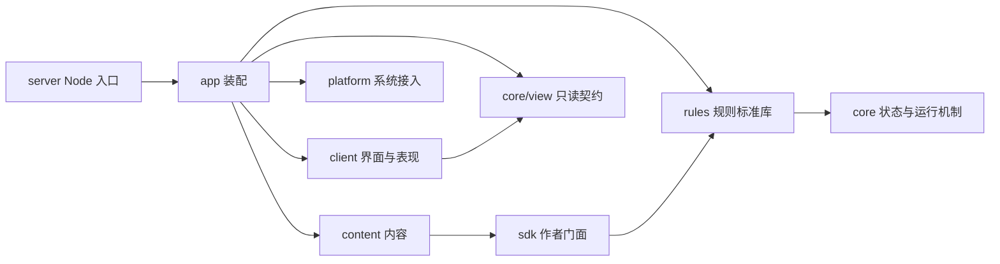

# 03 · 架构与模块

状态：当前模块与所有权契约。范围和验证见 [STATUS](STATUS.md)，取舍见 [路线](11-offline-roadmap.md)，执行语义见 [04](04-resolution.md)。每局只有一个权威规则执行实例；不引入服务拆分、ECS、消息中间件或依赖注入框架。

## 五个主要概念

| 概念     | 责任                                                   | 不能混淆的边界                                   |
| -------- | ------------------------------------------------------ | ------------------------------------------------ |
| World    | 当前权威状态：角色、牌、区域、阶段、状态实例           | 不存 UI 对象、Promise、函数或 Spine 实例         |
| Flow     | 一段可等待的结算过程，拥有父子因果、结果和作用域       | 不等同于一个触发时点，也不要求把函数编译成状态机 |
| Window   | 显式开放的规则裁决时点，等待所有触发处理完成           | 不是不等待订阅者的普通事件总线                   |
| Decision | 引擎暂停并请求玩家选择，具有稳定的输入输出与运行时验证 | 不等同于一个对话框，校验闭包无需序列化           |
| Fact     | 已经提交、不可被后来技能改写的语义记录                 | 不等同于草案、表现通知或函数调用栈               |

运行时只提供执行、窗口、选择、提交、作用域和记录机制；伤害、用牌、判定、死亡等由规则库编排。核心可以知道牌、角色、区域这些本游戏的基础结构，不追求“可运行任意桌游”的通用引擎。

## 依赖方向

箭头表示“左侧导入右侧”。`app` 装配对局与客户端，`server` 装配 Node 主持进程；登记技能定义时把内容注入运行实例，核心不反向 import 内容。



`sdk` 精选导出 core 与 rules 的实际类型和操作，不复制实现。内置内容是普通 `ContentDefinition`，由 [createContent](../src/content/catalog.ts) 直接组合，不经过包元数据或依赖清单。未来扩展同样通过内容定义与目录注入；没有第二套包格式、加载器或编译器。对局不读取分发版本，也不将它们写入 World。`core/view` 定义可展示的数据和输入值，不导出 World 写入器；[本地主持侧](../src/app/offline/session.ts) 负责把规则状态投影成 GameView。

当前目录如下；不把尚未建立的接口或目录列为既有实现。

```text
src/
  core/
    model/           # 基础实体、区域、Change 与冻结数据
    state/           # World、同步提交、基础不变量
    runtime/         # Flow、Window、作用域、调度和随机源
    decisions/       # 选择会话、候选与回复验证
    history/         # 顺序事实、作用域查询、轨迹
    view/            # 视角数据与客户端输入契约
  rules/
    turn/            # 回合、阶段、跳过与插入
    cards/           # 使用、响应、目标、判定、牌移动
    combat/          # 伤害、护盾、回复、濒死和死亡
    characters/      # 武将、性别和势力
    costs/           # 支付、次数与同步宣告
    skills/          # 实例、触发、主动能力与具名查询
    effects/         # 独立效果及其绑定
    state/           # 类型化局内标记
    scopes/          # 领域生存期和到期善后
    game/            # 身份、胜负与模式装配
  sdk/               # 内容作者使用的公共导出
  content/
    standard/        # 武将、卡牌、技能、文本与资源声明
    workshop/        # 演武内容，用于机制边界
  client/
    table/           # Pixi 战场、卡牌、角色和指示
    panels/          # Svelte 面板、说明、菜单和选择器
    interaction/     # 选择草稿与输入
    presentation/    # 音频、帧序列与独立 Spine 演示；完整表现时序后置
  platform/          # 浏览器/WebView 前后台观测
  app/               # 组装对局、客户端与本地/远端输入
    offline/         # 本地装配、投影与托管
    network/         # 席位绑定、数据协议、远端展示适配
  server/            # Node HTTP / WebSocket 主持进程
examples/content/    # 渡口、画阁等普通作者源码模块
tests/
  scenarios/         # 跨模块的真实机制反例
  fixtures/          # 小型牌堆、脚本化回答、指定种子
src-tauri/           # Windows / Android 原生壳与构建配置
```

测试可与实现相邻；`tests/scenarios` 用于完整结算案例。格式化与静态检查只覆盖新项目文件。

## 内核入口

| 模块                                                                                      | 责任                                                       |
| ----------------------------------------------------------------------------------------- | ---------------------------------------------------------- |
| [World](../src/core/state/world.ts)、[immutable](../src/core/model/value.ts)              | 每局状态、原子变更准备、只读快照、实体牌唯一位置           |
| [Room / Context](../src/core/runtime/room.ts)、[Scope](../src/core/runtime/scope.ts)      | 串行执行、父子因果、中止传播、同步资源释放与故障冻结       |
| [Window](../src/core/runtime/event.ts)                                                    | 类型化时点与具名顺序组；候选调度由 Room 负责               |
| [DecisionHub](../src/core/decisions/hub.ts)                                               | 活跃请求、预览、token、最终验证、一次接纳与关闭            |
| [Journal](../src/core/history/journal.ts)、[rebuildWorld](../src/core/history/rebuild.ts) | 有序事实、原因链、历史查询与状态重建                       |
| [SDK](../src/sdk/index.ts)                                                                | 作者使用的实际类型和规则操作；用法见 [05](05-authoring.md) |

## 所有权

| 数据                             | 所有者              | 读取与修改方式                             |
| -------------------------------- | ------------------- | ------------------------------------------ |
| 角色体力、牌位置、阶段、技能状态 | 单个对局的 World    | 规则通过语义操作提交；内容拿只读视图       |
| 本次伤害数量、本次用牌目标计划   | 当前 Flow 草案      | 在允许的窗口内通过领域方法修改             |
| 临时局部变量、验证闭包           | 当前函数/Decision   | 不放入持久状态；生命周期结束后释放         |
| 技能定义、牌定义、模式定义       | 本局装配的定义目录  | 启动前登记并校验；对局内不热替换代码       |
| 已选卡牌、拖拽位置、展开面板     | client 本地交互状态 | 提交带请求 ID/token 的输入，由规则最终验证 |
| 已知牌面、可观察事件             | viewer 投影         | 按观察权限产生，不以遮住 UI 代替投影       |
| 时间线与原因链                   | runtime/history     | 运行时记录，内容使用类型化查询             |

同一技能的定义可供多个角色共享；每个角色的技能实例、次数和状态必须独立。定义中不得放可变的局内计数器。多个 Room 可在同一进程独立运行，不存在全局 `currentRoom/currentEvent`。

World、事实和接纳的决策值只包含普通有限数据。immutable 复制可变输入并深冻，只共享自身已经验证的冻结子图；外部浅冻结对象仍会复制。单次复制保留重复引用和稀疏数组，拒绝循环及非普通数据；内部弱集合不强持有旧对局。World 对初始输入和批次候选先固定快照，再验证实际保存的值；候选通过验证后才可发布，失败不改变原状态。

World.prepare 保留本批未涉及的冻结表和区域；只有参与移牌的区域重新构造牌序，体力、技能与状态变化分别替换自己的表。每次提交仍产生新 revision，并完整验证下一状态；交换、同区重排与多次置顶保持原批次顺序，旧快照和事实不受影响。技能 Query 先筛选匹配的修正，再检查对应拥有者与来源资格，贡献顺序和同步查询约束保持。

WorldReader.state(id) 按 ID 返回当前状态条目，缺失时为 undefined；类型化状态仍通过 readState 校验读取。实体牌与状态索引各自跟随对应的不可变表身份，每个 World 只保留最近使用的一份索引，换表后首次读取重建；同 revision 的快照替换同样生效，不缓存技能资格或查询结果。

## 一次操作如何贯穿系统

1. 客户端在当前 Decision 内选择材料和目标，向选择会话请求预览。
2. 运行时在当前 World 与当前草案上计算候选、拒绝原因和可完成性。
3. 玩家确认后提交带 request ID 的回复。运行时最终校验，接纳并关闭选择。
4. 规则流程执行支付、用牌、响应、伤害等嵌套 Flow。
5. 每次同步提交更新 World，并产出按顺序编号的事实。
6. 主持侧按观察者生成新投影，界面据此更新牌桌、选择和公开记录。

当前每个主持实例在一个 JS 线程中执行对局；嵌套规则串行执行，资源加载和动画可以独立并行。若实测表明规则阻塞输入，再考虑将无 DOM 核心移到 Worker，并补端口适配。

## 显示与规则解耦，但不放弃节奏

规则负责“发生了什么”，表现负责“如何让人看清”。规则不等待 `animation.finished`，不调用 `setTimeout` 来模拟结算。

当前界面由投影刷新驱动，AI 的展示延迟由 LocalSession 管理；完整的事实动画队列仍后置。将来加入表现时序时，必须支持跳过或禁用动画，并保证输入对应当前 Decision，不能让动画丢失阻塞规则。

Pixi 与 DOM 共用一个逻辑战场坐标映射。静态边框与立绘由 Pixi 绘制，状态、区域牌与操作由 Svelte 承接，指示线使用独立 SVG。角色命中与键盘操作使用共享坐标的 DOM 按钮；不能让两个系统同时处理同一次点击。浮层捕获输入，战场暂停对应命中区域。

## 现有适配边界

LocalSession 负责离线输入与基础 AI；NetworkRoom 持有连接与开局草稿，全部准备后才由普通工厂函数创建新的 RoleMatch。房间可连续开局，同时至多保留一局；结束后各人独立返回准备页，不把草稿放入 World。WebSocket 只传对应席位的投影、预览与回答，局号限定远端决策身份；两种会话共用选择解释，不复制合法性，普通技能仍在主持端执行。边界见 [16](16-local-client.md#联机纵切)，阶段安排见 [路线](11-offline-roadmap.md)。

平台生命周期、文件加载和内容持久化留在装配与原生壳中，不渗入技能代码。未来端口按实际适配需要形成，不预建工厂或继承树。

Windows 主持入口只提供状态、创建与关闭三个平台命令。[原生壳](../src-tauri/src/desktop_host.rs) 拥有随包 Node 子进程；[入口](../src/server/desktop-host.ts) 装配同一个 NetworkRoom，规则仍全部为 TypeScript。原生壳退出关闭 stdin，主持端据此释放房间与监听；客户端只观察平台状态并使用既有 RemoteSession 加入，不持有第二份对局。

## 历史、录像和恢复

历史至少保存结构化的移动、伤害、使用、阶段与决策记录，带 `seq / flowId / parentFlowId / scopeId / reason`。因果树回答“为什么发生”，单调序号回答“先发生什么”，两者不能互相替代。

事实回放必须有足够的提交数据和对应 reducer，不能靠中文日志重建状态。当前可检索事实与轨迹，并从完整事实重建状态；完整录像播放器仍后置。

World 重建只恢复已记录的事实状态，不能恢复技能栈、监听闭包、挂起选择或随机源当前位置。进程被杀后的续局以后可采用“固定内容版本 + 初始状态 + 随机流 + 已接受决策重执行至边界”，但还需要确定性验证与副作用抑制。当前不为此制造技能 DSL。
