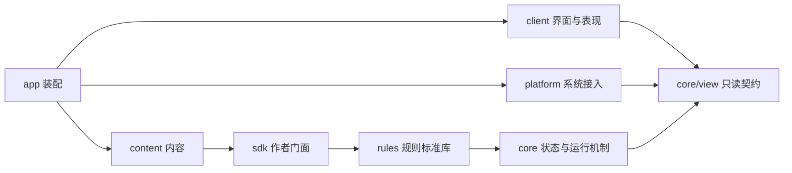

# 03 · 架构与模块

状态：整体设计契约；World、Flow、Window、Decision、提交、作用域和历史的首批运行机制已实现，具体边界见 [10 · 内核实施](10-kernel.md)。完整规则、技能与投影仍待实现。采用一个应用、一个规则执行实例、清晰的模块依赖，不引入服务拆分、ECS、消息中间件或依赖注入框架。

## 五个主要概念

| 概念     | 责任                                                   | 不能混淆的边界                                   |
| -------- | ------------------------------------------------------ | ------------------------------------------------ |
| World    | 当前权威状态：角色、牌、区域、阶段、状态实例           | 不存 UI 对象、Promise、函数或 Spine 实例         |
| Flow     | 一段可等待的结算过程，拥有父子因果、结果和作用域       | 不等同于一个触发时点，也不要求把函数编译成状态机 |
| Window   | 显式开放的规则裁决时点，等待所有触发处理完成           | 不是不等待订阅者的普通事件总线                   |
| Decision | 引擎暂停并请求玩家选择，具有稳定的输入输出与运行时验证 | 不等同于一个对话框，校验闭包无需序列化           |
| Fact     | 已经提交、不可被后来技能改写的语义记录                 | 不等同于草案、表现通知或函数调用栈               |

运行时只提供执行、窗口、选择、提交、作用域和记录机制；伤害、用牌、判定、死亡等由规则库编排。核心可以知道牌、角色、区域这些本游戏的基础结构，不追求“可运行任意桌游”的通用引擎。

## 依赖方向

箭头表示“左侧导入右侧”。`app` 是唯一装配入口；登记技能定义时把内容注入运行实例，核心不反向 import 内容。



`sdk` 是精选导出与少量组合辅助函数，不是复制 rules 的另一套实现。`core/view` 仅包含可以显示和交互的数据、端口类型，不导出 World 写入器。客户端不能通过这个路径获得规则内部的可变对象。

目录职责如下；已实现目录与尚未创建的目录并列说明，不创建空壳类占位。

```text
src/
  core/
    model/           # ID、基础实体、区域、事实与结果类型
    state/           # World、同步提交、基础不变量
    runtime/         # Flow、Window、作用域、调度和随机源
    decisions/       # 选择会话、候选与回复验证
    history/         # 顺序事实、作用域查询、轨迹
    view/            # 视角投影和客户端端口契约
  rules/
    turn/            # 回合、阶段、跳过与插入
    cards/           # 使用、响应、目标、判定、牌移动
    combat/          # 伤害、回复、失去体力、濒死和死亡
    queries/         # 距离、上限、禁止和费用等纯查询
  sdk/               # 内容作者使用的公共导出
  content/
    standard/        # 武将、卡牌、技能、文本与资源声明
    modes/           # 身份规则等模式入口和规则策略
  client/
    table/           # Pixi 战场、卡牌、角色和指示
    panels/          # Svelte 面板、说明、菜单和选择器
    presentation/    # 动画序列、音频、Spine、资源生命周期
    devtools/        # 调试时间线、技能来源、决策检查器
  platform/          # 文件、应用生命周期、窗口等适配
  app/               # 组装本地对局、客户端和平台
tests/
  scenarios/         # 跨模块的真实机制反例
  fixtures/          # 小型牌堆、脚本化回答、指定种子
src-tauri/           # P0 创建：最小应用壳
```

测试可与实现相邻；`tests/scenarios` 用于完整结算案例。格式化与静态检查只覆盖新项目文件。

## 所有权

| 数据                             | 所有者              | 读取与修改方式                             |
| -------------------------------- | ------------------- | ------------------------------------------ |
| 角色体力、牌位置、阶段、技能状态 | 单个对局的 World    | 规则通过语义操作提交；内容拿只读视图       |
| 本次伤害数量、本次用牌目标计划   | 当前 Flow 草案      | 在允许的窗口内通过领域方法修改             |
| 临时局部变量、验证闭包           | 当前函数/Decision   | 不放入持久状态；生命周期结束后释放         |
| 技能定义、牌定义、模式定义       | 对局固定的 Registry | 启动前登记并校验；对局内不热替换代码       |
| 已选卡牌、拖拽位置、展开面板     | client 本地交互状态 | 不直接修改 World；提交意图或 DecisionReply |
| 已知牌面、可观察事件             | viewer 投影         | 按观察权限产生，不以遮住 UI 代替投影       |
| 时间线与原因链                   | runtime/history     | 运行时记录，内容使用类型化查询             |

同一技能的定义可供多个角色共享；每个角色的技能实例、次数和状态必须独立。定义中不得放可变的局内计数器。多个 Room 可在同一进程独立运行，不存在全局 `currentRoom/currentEvent`。

## 一次操作如何贯穿系统

1. 客户端在当前 Decision 内选择材料和目标，向选择会话请求预览。
2. 运行时在当前 World 与当前草案上计算候选、拒绝原因和可完成性。
3. 玩家确认后提交带 request ID 的回复。运行时最终校验，接纳并关闭选择。
4. 规则流程执行支付、用牌、响应、伤害等嵌套 Flow。
5. 每次同步提交更新 World，并产出按顺序编号的事实。
6. 投影把事实和新视图交给表现队列；界面播放移动、伤害与 Spine，生成说明文本。

第一版在一个 JS 线程中完成本地对局；嵌套规则串行执行，资源加载和动画可以独立并行。先不加 Worker；若实测表明规则阻塞输入，再将无 DOM 核心移到 Worker，并补端口适配。

## 显示与规则解耦，但不放弃节奏

规则负责“发生了什么”，表现负责“如何让人看清”。规则不等待 `animation.finished`，不调用 `setTimeout` 来模拟结算。

表现层按事实序号排队，并允许合并、加速和跳过动画。进入新的 Decision 时，主持层可以等界面呈现到相关事实序号再开放点击，避免玩家操作一幅落后的画面；动画丢失或禁用时仍能完成这一步。自动测试使用即时表现适配器。

Pixi 与 DOM 共用一个逻辑战场坐标映射。当前战场由 Pixi 绘制，角色命中与键盘操作由共享坐标的 DOM 按钮负责；文本和复杂面板属于 Svelte。不能让两个系统同时处理同一次点击。浮层捕获输入，战场暂停对应命中区域。

## 为未来留下的接口

- `DecisionPort`：本地输入、脚本化测试，未来接远端输入或智能决策。
- `ViewerProjection`：UI 和未来 AI 的信息边界；不是完整反作弊设施。
- `PlatformPort`：文件和生命周期不渗入技能代码。
- `JournalSink`：先内存记录/调试导出，未来再做录像格式和存储。

这些可以是几个函数组成的对象，不需要每个端口一套工厂和继承树。网络协议、大厅、匹配、AI 搜索、多进程和沙箱均后置。

## 历史、录像和恢复

历史至少保存结构化的移动、伤害、使用、阶段与决策记录，带 `seq / flowId / parentFlowId / scopeId / reason`。因果树回答“为什么发生”，单调序号回答“先发生什么”，两者不能互相替代。

事实回放必须有足够的提交数据和对应 reducer，不能靠中文日志重建状态。第一版只承诺可检索轨迹与导出设计，不承诺完整录像播放器。

World 快照只能恢复已记录的事实状态，不能恢复任意 `await` 处的 JS 栈。进程被杀后的续局以后可采用“固定内容版本 + 初始状态 + 随机流 + 已接受决策重执行至边界”，但还需要确定性验证与副作用抑制。当前不为此制造技能 DSL。
