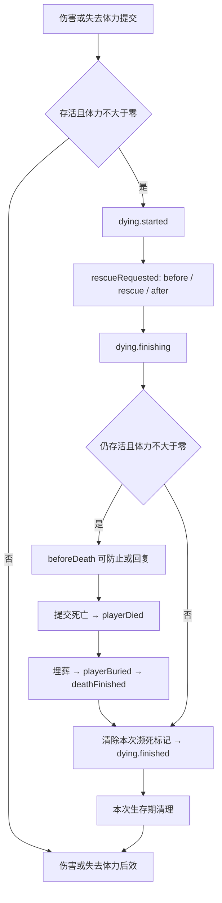

# 15 · 生命结算与基础身份对局

日期：2026-10-16。对局装配已能从初始化、轮流出牌推进到身份胜负，使用正式规则与决策。后续[正式客户端](16-local-client.md) 已接入；现有牌与武圣仍是内容子集，不代表完整标准包。

## 生命流程

[life](../src/rules/combat/life.ts) 是规则标准库，Room 不理解“濒死”或“主公”。伤害和失去体力调用同一个 `enterDying`；回复不复活已死亡角色。



图中的 beforeDeath 若防止死亡，直接进入本次濒死收束；若末尾已回复，同样不再提交死亡。终局已确定时不再启动救援、死亡或伤害后窗口，仍保留必要的流程完成与清理记录。

每次濒死有独立 ID、来源事实序号、原因快照与 Lifetime。标记按本次 ID 管理，内层濒死完成只清除自己，不能清掉外层仍在结算的标记。`dyingFinished` 的结果为 rescued / dead / prevented / unavailable；unavailable 包括其他嵌套效果已经确定终局的情况，不能将其称为“救回”。

`damage` 返回的 afterHp 是这次伤害提交后的体力，救援后的当前体力从 World 读取。来源快照、伤害提交事实和后续回复不相互覆盖。`loseHp` 不触发伤害窗口，也没有伤害来源或击杀奖励来源。

回复准备 recovering 只在目标存活且未终局时继续；目标死亡/终局后不再执行其后续候选或费用。零尝试量与满体力本身不会关闭准备窗口，提交仍按当前体力/上限裁剪；已经提交的 recovered 事实不因后效死亡而改写。具体边界和真实桃整合见 [52](52-life-boundaries.md)。

## 救援与作者扩展

[installRescue](../src/rules/combat/rescue.ts) 安装标准救援规则：从当前回合角色起按座次，无回合时从濒死者起；存活救援者可以连续使用桃，直到目标体力大于零、放弃或不再可用。负体力按实际缺口逐张结算。未实现酒与其他扩展包的救援规则。

`CardBook.askUse(ctx, { actor, names, targets, timing, prompt })` 征询一次用途固定的用牌。主持侧固定角色、目标和 rescue 时机；回复只提供 physical / viewAs。最终检查名称、材料、转换实例、用牌与目标禁止，再进入完整 `use` 管线。救援因此会提交 `card.used`，触发用牌窗口并清理处理材料，不提交 `card.responded`。闪、决斗中的杀仍使用响应管线。

可在 rescueRequested 的 before / after 组增加普通技能，也可在 dyingStarted、dyingFinishing、beforeDeath 开放的语义点进行其他操作。多个技能的嵌套用普通 `await` 表达；没有内容名称特判或专用救援 DSL。转换候选仍是配方家族，不枚举材料组合，实际合法性由最终校验判定。

## 死亡与埋葬

`kill(ctx, { player, killer, cause, reason })` 也可由直接死亡规则调用。beforeDeath 草案仅允许 `prevent(reason)`；封口或关闭后修改会报错。死亡不把体力强行改成零，保留导致死亡的实际提交值。

beforeDeath 只处理仍待决的死亡：已经防止、嵌套死亡处理、终局或濒死目标已获救便停止剩余候选。濒死死亡请求入口已有正体力时直接返回 rescued；规则直接死亡不使用这项豁免。已提交死亡后的事件与埋葬继续自己的流程，见 [52](52-life-boundaries.md)。

1. 提交 alive=false；DeathEvent 保存死亡前角色、所属区域与技能快照。
2. 开放 playerDied；拥有 `allowDead: true` 的死亡技能可读取快照并移动遗赠等牌。普通技能默认因拥有者死亡而失效。
3. 重新读取当前所属区域，把余牌移到弃牌区，同时移除该角色剩余技能实例，一次提交后才开放 cardsMoved。
4. 开放 playerBuried 和 deathFinished，后者提供 mode / after 顺序组。

处理区属于具体用牌，不属于出牌者。来源死亡不会夺走处理材料或消除已产生效果；死亡技能取走的牌也不会被埋葬重复弃置。独立领域状态按自己的生存期管理，死亡不笼统抹掉全部状态。异常冻结当前现场，保留已提交死亡，不伪造埋葬完成或回滚。

复活、死者继续拥有持久技能、装备离场遗留等扩展机制尚未实现；应明确新语义再扩充。

## 身份模式与运行时收束

[roles](../src/rules/game/roles.ts) 采用基础 2 至 8 人身份配置，五人以上主公初始体力与上限加一。主公死亡时，唯一存活内奸胜，否则反贼阵营胜；主公存活且反贼、内奸全部死亡时主忠阵营胜。阵营胜者包含该阵营已死角色。

本项目当前明确选择：死亡效果与埋葬完成后判胜；对局仍继续才执行击杀奖惩。存活来源击杀反贼摸三张，主公杀忠臣弃置手牌和装备。无来源或来源已死亡不获奖励。该顺序是本项目基线，不声称覆盖所有版本或与参考实现逐时点一致。

[finishGame](../src/rules/game/end.ts) 将结果提交到 World，只确定一次。模式监听 gameFinished 后调用 `room.finish`，立即关闭输入，并阻止未来输入；当前根流程继续完成用牌、处理区、阶段和生存期善后后，Room 才变为 ended。新用牌、响应、伤害、回复、支付和摸牌均检查终局。底层移动与提交保留给善后使用。

`room.abort` 仍是立即中止；它保留诊断现场。`room.finish` 是正常终局的收束路径。收束中的异常仍会使 Room faulted，不能伪装成成功结束。

## 对局装配与当前接口

[RoleMatch](../src/app/offline/role-match.ts) 装配 Room、牌/技能目录、救援和身份规则：

```ts
const match = new RoleMatch({
  id: 'local-1',
  seed: 42,
  players: [{ id: 'a' }, { id: 'b' }, { id: 'c' }, { id: 'd' }],
  deck,
  content: { cards: standardCards, skills: [wusheng] },
});

// start = prepare + play。无 UI 依赖；运行到决策时挂起。
const running = match.start();
// 主持侧通过 match.room.decisions.pending / preview / submit / cancel 回复。
const result = await running;
```

prepare 使用局内随机源分配身份、洗牌，从主公起发四张起手牌，并在发牌前授予预设技能。也可指定固定身份、角色体力、预设技能、牌定义、纯查询和普通 PhaseBody，作为预设局或内容测试入口。prepare 只能成功进入一次；异常遵循 Room 故障语义。

每回合前有必选 `seat-ready` 准备决策，随后运行六阶段，跳过已死亡座位。手动演练需要本人确认；默认单机由主持侧自动确认并控制非主控角色，见 [26](26-basic-ai.md)。无牌、无动作时仍有这个决策边界，主持侧可以等待输入或安排节奏，避免无限空转。进度中的回合数与下一席位保存在 World；Promise、Lifetime 和闭包不属于存档，也不能靠状态重建恢复挂起流程。

身份全表是执行侧状态，客户端不能直接把整份 World 当显示模型。[席位投影与决策面板](16-local-client.md) 已隐藏其他身份/手牌，并在交接时清除上一席位的私有内容。额外回合与现有内容的覆盖范围见 [STATUS](STATUS.md)。

## 验证与参考

本批 27 项新场景：[生命流程](../tests/scenarios/life.test.ts)、[身份与对局](../tests/scenarios/role-match.test.ts)、[正常结束](../tests/scenarios/finish.test.ts)。覆盖连续用桃、转换、用牌禁止、遗赠、埋葬原子性、同角色嵌套濒死、嵌套死亡、来源死亡、击杀奖惩、确定性初始化、空动作热座循环、真实出牌到胜负和提交事实重建。

参考本地 [FreeKill 生命结算](../../freekill/ltk/server/events/death.lua)、[救援游戏规则](../../freekill/packages/standard/aux_skills_dir/game_rule.lua)、[身份说明](../../freekill/packages/standard/i18n/zh_CN.lua)，以及 [noname content](../../noname/resources/app/noname/library/element/content.js) 的 dying / die。FreeKill 在 GameOverJudge 后才开放 Death / BuryVictim；noname 的濒死队列和 DOM 死亡处理有自己的版本行为。本项目只吸收明确规则与反例，未导入其架构或声称完全兼容。参考项目文件未修改。
