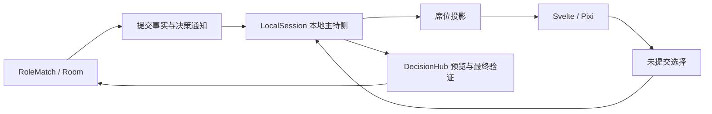

# 16 · 正式规则客户端与本地单机

更新：2026-11-03。主入口已从 P0 演示状态替换为正式 RoleMatch，浏览器可通过实际界面从开局走到身份胜负。默认标准＋EX 为 32 种牌、108 张实体牌，另可选择机制练习（见 [23 · 两件剑与标准牌组](23-swords-standard-deck.md)）。当前可选二十五名标准武将，AI 席位可保留循环预设或统一指定武将；目录与主动技能边界见 [27](27-generals-active-skills.md)，弃置与新增武将见 [28](28-discard-martial-generals.md)，魏将与判定/回合效果见 [29](29-wei-judgment-effects.md)，谋士与私有牌池见 [30](30-strategists-private-pools.md)。

默认固定人类控制甲席，其余角色使用基础 AI，不再交接设备。本人可托管给同一策略并收回，手动多席操作保留为内容调试选项。平台与交付范围见 [STATUS](STATUS.md)。

## 启动与大厅

启动页以当前牌桌与“开始对局”为主要操作，显示人数、牌组和实际阵容，可直接切换 2 / 4 / 6 / 8 席；点击本人头像进入武将一览换将。本人 / AI 标识与单机大厅共用同一份席位展示数据，实际开局仍使用原 lineup。“开始对局”位于阵容列表前，小窗口也可在首屏直接开局；复用单机大厅的开局入口与校验，错误留在当前页展示。调整配置、联机和内容浏览为次级入口。单机大厅将武将、席位、AI 与牌组集中为常用设置，种子和手动控制收在默认折叠的“演练与复现”中；摘要始终显示控制方式和种子，展开状态随草稿保留，种子校验失败时自动展开。底部显示摘要与开始按钮，武将一览可从当前武将旁直接进入，并将焦点交给页面标题。手动演练只显示自由席位，不把普通武将预设误报成调试局的实际角色。

[LobbyShell](../src/client/panels/LobbyShell.svelte) 参考 FreeKill 的启动页与大厅分工：启动页左侧立绘、右侧操作；桌面大厅左侧固定分区导航，右侧配置与内容侧栏，较窄窗口改为横向导航。当前分区有明确标识，切页后焦点交给标题。导航仅是 App 的本地状态，切换页面保留人数、种子与未提交配置，不改变 World 或房间；未入房时点击顶部标题也在本地返回首页，保留连接地址并将焦点交给首页标题。开局前牌桌对输入和辅助技术隐藏；实际开局后才展示对局。标准与机制演武直接从普通源码组合，内容库、导入和安装持久化已移除。

首页、大厅与房间准备阶段不创建 Pixi/WebGL 战场。战场随实际对局创建，保留到离开对局或终局页面时释放；快速返回大厅后，迟到的异步初始化不能重新插入画布、布局或就绪状态。大厅导航和内容管理不以渲染器就绪为前提，已有 World 与内容装配边界不变。

[NetworkSetup](../src/client/panels/NetworkSetup.svelte) 在支持主持的平台提供创建配置，其他平台可填写地址加入；不展示虚构房间目录。[RoomLobby](../src/client/panels/RoomLobby.svelte) 以席位卡、房间信息与选将/准备操作组织等待页。准备立绘来自主持端的公开展示信息，使用与牌桌相同的资源租期，离开时一起释放；身份和手牌仍等正式开局产生。桌面、窄横屏与竖屏保持相同流程，空间不足时在大厅内滚动。

Android 系统返回先取消最上层弹窗，再触发当前界面声明的返回按钮：大厅子页回首页，记录面板关闭，对局中进入暂停。暂停层可继续原草稿，或明确结束本局并返回大厅；再次按返回不会悄悄结束对局。首页返回把任务移至后台。导航和返回均复用现有按钮，不提交选牌草稿或改写结算状态。

## 所有权与数据流

[LocalSession](../src/app/offline/session.ts) 持有执行者、查看许可、订阅与输入转发。[GameView](../src/core/view/game.ts) 只有展示数据，不携带 World、原始历史 detail 或执行闭包。组件不导入规则模块，也不计算杀的距离、用牌次数、桃的目标等规则。

主控席位由主持侧固定，基础 AI 只拿到独立的信息受限观察，通过同一 DecisionHub 预览与提交。AI 私有请求不会进入人类视图；`automated` 只标识当前等待的角色，`control` 表达本人托管状态与交还原因，`paused` 标识主持侧暂停状态。策略与调度边界见 [26](26-basic-ai.md)。

[投影](../src/app/offline/projection.ts) 显示公共体力、性别、存活、手牌数量、装备与技能；身份只显示主公、当前本人、已死亡角色，终局揭示全表。单机视图只包含甲席手牌；手动演练只包含当前确认席位的手牌。其他人的牌不通过隐藏 DOM 保存。

日志只解释已明确公开的事实：摸牌数量、公开用牌/响应、体力变化、弃牌数量、死亡和胜负。原始洗牌顺序、起手内容和选择细节不透传。最近用牌保存语义牌快照，处理状态只追踪已宣告公开的材料；不能把任意 processing 区域都当作公开牌。

Journal 按提交、决策开放/关闭和故障异步通知，避免在提交中执行组件代码。订阅释放后不再调用观察者；Room 的权威执行不等待动画、帧率或视图更新。

本地投影出错时主持侧停止本局并撤销 AI 待执行任务，保留原始错误与已提交事实。错误视图使用印刷牌面，避免再次执行失效的修正规则；运行核已经故障时也采用同一路径。单独调用 Room.inspect 的错误仍只关闭自身只读上下文，不冻结运行核。

主持侧预览、提交及请求刷新中的规则异常也走同一停止/报告路径，对界面返回不可操作结果。组件通知异步发布，避免派生预览同步改写组件状态。普通不合法选择仍返回可重选的校验结果；代码故障关闭本局。

## 固定主控与手动演练

单机自动确认 seat-ready 并控制非主控角色。自己的身份、手牌与右下席位不因其他角色出牌、响应或救援而切换；人类不能代答 AI 请求。暂停和后台事件会藏牌、撤销 AI 定时任务；恢复后明确点击继续。已经提交的规则结算正常善后，在下一次决策处等待。

勾选“手动演练（内容调试）”时，每回合的 seat-ready 需要本人确认。响应或救援切换操作者时，也先撤销上一席位许可：投影手牌为空、私有决策为空，清除已选材料、目标和详情，再显示原生 dialog 交接遮罩。Esc 不能绕过交接。交接令牌匹配当前请求；旧令牌不能开启后来的请求。

手动演练的“隐藏手牌”和页面隐藏事件会撤销查看许可，恢复后重新确认。它们不移动牌、不消耗次数、不推进回合。演练模式的所有席位均由人操作；没有账户或联机控制。

## 决策与交互

| 执行侧决策    | 当前界面                                                                       |
| ------------- | ------------------------------------------------------------------------------ |
| play-action   | 技能、材料与有序目标编辑同一草稿，一次提交；有草稿时取消选择，空草稿才结束出牌 |
| card-response | 闪/决斗中的杀，可打出或放弃                                                    |
| use-card      | 固定用途用牌；救援桃与锦囊反制不需要手工目标                                   |
| cards-targets | 手牌/公开牌池/私有选项、多目标反馈、强制弃牌不可取消                           |
| invoke        | 发动 / 不发动                                                                  |
| trigger-order | 可读技能名按钮，回复稳定 ID                                                    |
| choose-option | 具名选项以可读按钮显示，回复稳定 ID                                            |
| arrange       | 有序分组、组内前后移动、上下限预览与最终确认；暂停隐藏私有内容                 |
| 其他          | 明确显示尚无该类面板，不自动取消或伪造回复                                     |

`CardBook.inspectUse` 在执行侧生成目标部分选择反馈，最终确认完整复用 validateUse。选择未完成也能区别可选目标与不可选目标。切换单目标时可以替换已选者；换牌时只保留仍合法的目标；预览不支付。转换配方支持零/多材料数量；有序分组与排序见 [37](37-arrangement-astrology.md)，带角色额度和逐项接收条件的分配见 [59](59-constrained-assignment.md)。任意参数表单仍未实现。

Svelte 的草稿可能是 Proxy，LocalSession 在输入边界把材料和目标复制为普通数组。不能把响应式草稿直接交给 structuredClone，也不能为方便 UI 放宽规则层的普通数据要求。已有回归场景使用代理数组验证这个边界。

[手牌](../src/client/panels/HandCard.svelte) 保留右键/触摸长按详情，滑动取消长按。大手牌通过容器内横向滚动访问；快捷键 1–9 选牌，Enter 确认，Esc 清除草稿。输入框、详情、动画模态和交接遮罩期间不截获游戏快捷键。

[布局](../src/client/table/layout.ts) 为 2–8 个席位计算唯一矩形；Pixi 绘制与 DOM 命中区域共用坐标。单机始终以甲席为焦点，暂停也保留位置；手动演练以当前确认角色为焦点，无查看许可时使用活动角色。本人固定右下；手牌左下、确认居中在上、技能邻近本人，牌堆右上、记录从左打开，区域契约见 [25](25-table-position.md)。可选、已选与不可选状态来自决策反馈。开局设置支持 2/4/6/8 人、标准/机制牌组和确定性种子；战场标题显示实际装配的牌组。真实角色性别来自武将；手动演练仍使用交替性别的机制角色。

参考本地 noname 的 [game.check](../../noname/resources/app/noname/game/index.js)（约 6941 行）与 [十周年 UI checkTarget](../../noname/resources/app/extension/十周年UI/extension.js)（约 3015 行）：分别更新牌、目标和确认状态，明显区分可选/已选。只吸收交互逻辑，没有导入其全局对象或源码。

## 验证入口

- [主持侧场景](../tests/scenarios/local-session.test.ts) 覆盖私有投影、授权、隐藏、关闭与真实规则回复；[基础 AI](../tests/scenarios/basic-agent.test.ts) 和 [联机会话](../tests/scenarios/network-session.test.ts) 检查控制权交接、迟到输入与托管整局。
- [浏览器场景](../tests/browser/client.spec.ts) 使用生产构建，覆盖默认单机、手动演练、选择与取消、目标反馈、技能面板、藏牌恢复和真实胜负；[联机场景](../tests/browser/network.spec.ts) 检查两个独立席位的视图与远端选择。脚本输入与 AI 自主决策分别验证，不把交互冒烟当作策略质量证明。
- 横屏与竖屏均检查手牌滚动、命中区域及详情。浏览器后台事件只证明客户端响应事件，不能代替 Android 系统生命周期验收。布局关系见 [25](25-table-position.md)。
- Windows 使用 `pnpm desktop:verify` 验证实际 WebView2、离线整局与内容跨进程恢复；`pnpm desktop:network` 验证两个独立原生客户端的真实选择、托管整局与返回单机。平台入口与环境见 [08](08-development-guide.md)。

当前结果、平台版本、报告路径与尚未验证的边界只在 [STATUS](STATUS.md) 维护；不在本契约累积各批测试数量。浏览器报告为 `.artifacts/validation/browser.json`，完整源码检查为 `.artifacts/validation/units.json`。

Windows 包与精确成员以 `.artifacts/builds/local-client-manifest.json` 为准，交付脚本核对归档字节与实际 Release 证明。内容组合与旧安装机制的退出见 [内容接口](39-source-packages.md)，二进制资源见 [独立资源](39-source-packages.md#资源与所有权)；Android 的已验收范围同样以 STATUS 为准。

额外回合队列、阶段计划和连续手动投影见 [24](24-extra-turns.md)。

## 联机纵切

`pnpm online` 依次构建页面与 Node 主持端，再监听 `127.0.0.1:1422`。默认四人身份、两名玩家与两席基础 AI、关羽/曹操/张飞/赵云及标准牌组，种子 42；`SGS_SEED` 可设为 1–4294967295 的整数。也可通过进程变量 `SGS_ROOM` 提供完整 [RoomSetup](../src/app/network/setup.ts) JSON：`seed`、`preset`、`lineup` 武将 ID 数组、`humans` 玩家人数；阵容长度决定总席位，前若干席由玩家依次加入，全部准备才开局。`SGS_ROOM` 提供时不再使用 `SGS_SEED`。`pnpm server:build` 和 `pnpm server:start` 可单独运行；页面需要先由 `pnpm build` 生成。`SGS_HOST` / `SGS_PORT` 只控制本进程监听地址；局域网需用实际主持机 IP 访问，自动选端口可用 0。

[NetworkRoom](../src/app/network/room.ts) 持有连接与准备草稿快照，同时至多持有一局 RoleMatch。创建时固定种子、牌组名称、武将目录、玩家列表与建局函数引用；原调用者继续修改配置不会改变该房间。主持装配只捕获已选牌组，不保留可变 RoomSetup 草稿供后来开局读取；准备页主动选将仍只修改该房间的玩家列表。全部人类连接准备后才调用工厂创建新局；连接、准备状态与对局编号不进入 World。[Node 入口](../src/server/server.ts) 提供同源静态页面与 `/game` WebSocket。[协议](../src/app/network/protocol.ts) 在准备阶段只传房间数据，GameView 为 null；开局后只传对应席位的 GameView、选择与预览结果，不发送 World、牌堆、其他席位私有决策、原始历史或闭包。连接持有绑定当前注册的命令入口，旧连接失效后不能借相同席位写入新连接，也不要求调用者为发送回调创造唯一函数对象。

游戏与准备命令携带当前局号，旧局号的准备、选将和游戏回复都被拒绝。主动离开属于连接生命周期，按当前注册身份处理，不因尚未收到新局号而失效。远端 Decision ID 另以局号限定，视为不透明标识；运行核即使重用局内 ID，旧答案也不能命中新局。主持侧映射到原请求后，再重核 token、拥有者并调用同一 DecisionHub；没有修改运行核的 ID 或技能代码。

[RemoteSession](../src/app/network/session.ts) 接入现有牌桌，连接时不借用另一局的初始视图。网络预览尚未返回时禁止确认，按局号、视图 revision、Decision ID/token 隔离缓存；不同草稿各自对应主持端结果，迟到响应不能覆盖新选择。切局使旧待答 Promise 结束，界面清除选择、详情与旧预览，并重置音频序号和指示线。提交等待主持端明确接受，界面忽略已结束决策的迟到错误。排序等专用回答也走同一通道。联机藏牌只隐藏本机画面，其他人和 AI 继续行动；需要该席回答时仍等待人类。

Windows 客户端在开局页展开“联机房间”，可以直接创建房间，或填写 `http://主持机:端口` / `主机:端口` 加入。同一个 RemoteSession 将地址规范到 `/game` WebSocket；HTTPS 使用 WSS。客户端保留自己的页面和内置资源，退出后直接回到单机开局；不会导航到远端 HTML。无效地址不关闭当前单机会话。

入席前双方交换构建摘要。页面、开发主持端和随包主持端均由 [同一构建函数](../scripts/network-build.mjs) 读取规则、协议、客户端、内置资源、锁文件与构建入口，注入确定性 SHA-256；不依赖手工版本号、时间戳、Git 状态或目标平台，文本统一 LF，媒体保留原字节。不同摘要或旧客户端会明确拒绝；不分配席位、不发送投影，断开不会影响已入席玩家。客户端也拒绝未先核对就发送的视图，两侧等待核对至多十秒。此摘要核对用于发现不同基础构建，不是签名或兼容协议；房间内容由主持端独立装配，加入者只接收展示与媒体。

[平台入口](../src/platform/hosting.ts) 通过原生壳创建随包 Node 主持端，不要求玩家安装 Node 或使用源码。创建者在开局页选择内置源码目录，再配置 2–8 席、玩家人数、所选目录中的牌组、初始阵容与房间种子，其余由基础 AI 控制。缩减席位保留阵容前缀并收敛玩家上限；退出后恢复上次创建配置，已失效的内容选择回落到可用项。准备页显示实际阵容、房间草稿与入席状态；玩家可选自己的武将、准备或取消，选将只撤销自己的准备。随机身份和起手牌在实际开局后才产生。

[主持装配](../src/app/network/setup.ts) 在日常路径直接选择与单机相同的标准或机制演武目录，不加载模块或包清单。创建者仅将演武开关和普通房间配置经原生 stdin 首行传给主持端；自定义主持入口可以直接注入 ContentCatalog，客户端不提供源码执行入口。之后保持 stdin 打开继续承载 EOF 生命周期；普通作者 console 输出走 stderr，stdout 只保留结构化启动通知。

自定义主持入口可向 createGameServer 注入普通 RemoteAsset 数据；加入者在连接内创建独立 Blob URL 并绑定到展示字段，跨局复用，离开时释放。资源绑定不修改选项 ID、答案或普通文案，规则仍只在主持端执行。

终局或中止后的规则收束完成后，各玩家可独立返回准备页，尚未返回者继续查看旧局结果；已返回者不再收到旧局私有视图。全部玩家再次准备才创建新局，连接和房间进程保留，旧局的 AI、历史订阅和待答引用释放，托管选择重置。第 N 局种子为 `((房间种子 - 1 + N - 1) % 4294967295) + 1`，在非零 uint32 范围递进，可据房间种子和局号重现。每局仍使用全新的 RoleMatch、World、随机流与结算栈，不恢复旧协程。

原生壳只传递普通配置数据，桌面入口和开发入口共用装配函数，不在 Rust 重写种子、武将或牌组规则。主持端绑定 `0.0.0.0`，端口可指定或填 0 自动分配。创建者自动用本机地址加入，顶栏列出实际 IPv4 网卡地址与复制入口。端口被占用时保持创建表单并给出原因。浏览器保留加入入口，独立开发主持端仍使用上面的 `pnpm online`。

原生壳串行管理自己创建的 Child；主持端通过 stdin EOF 感知拥有者退出，关闭 NetworkRoom、连接和监听。界面关闭房间或离开联机也关闭自有主持端，普通加入者离开只关闭自己的连接。状态通过带 revision 的事件与初次查询同步，异步旧状态不能覆盖新状态。关闭后可在同一界面重新创建；同房间开下一局则不重建进程或 WebSocket。

原生 [CSP 配置](../src-tauri/tauri.conf.json) 的 connect-src 开放 WS/WSS，保留脚本、资源和 IPC 策略；预览服务器直接返回该策略的 HTTP 响应头。Windows 验证入口、隔离进程与当前证明格式统一见 [08](08-development-guide.md#windows-运行验证)，实际通过范围仅维护在 [STATUS](STATUS.md)。

短暂断线保留席位凭据、原 RoleMatch、World、DecisionHub 和实际挂起请求，不中止、重放或重启规则。人类请求自然等待；已开启的托管及其他 AI 仍按原选择行动，不因断线自动代答。主持端用 WS ping/pong 检查连接，并发送不进入事实流的 pulse；客户端超过 25 秒没有消息时切换到可重连状态，覆盖静默断网。定时器与旧 socket 一起清理，旧连接的消息、离开通知和预览回调不能影响新注册。

构建核对后，主持端单独向本人发席位凭据，再发送私有投影。重连携带凭据，恢复同一席位；同席的新注册取代旧注册，旧连接得到明确提示。凭据不是 World 或规则状态，不广播给其他玩家。客户端只在 localStorage 保存最后一个房间的地址、席位名和凭据，不保存手牌、草稿、原请求或函数栈；存储不可用时仍能在当前窗口重连。短暂失联可点“重连原席位”；页面刷新或重新启动加入者程序后，在开局页点“返回原房间”，不会静默接管最近的席位。程序重启需继续使用原用户目录，主持端也必须仍在运行。

失联时隐藏手牌、私有池、本人隐藏身份与操作入口，结束旧待答 Promise 并清空预览，不自动重发提交。重新核对后建立新的资源 URL，读取该席当前投影；原请求未完成时继续回答它，已完成时以主持端新请求为准。首次同步将公开音频/指示线的序号推进到当前基线，不补播失联期间或刷新前的旧表现；后续新事实照常播放。

“离开联机”是显式退出，会结束当前活跃局并忘记本机回房记录。有人断线时，仍在房间的玩家可点“结束本局”，待规则收束后回到准备页。活跃局不允许没有凭据的新玩家补位；准备阶段或终局后允许占用断线空位，新玩家只进准备页，旧凭据随该席重新分配而失效。已经离开的席位不能靠旧凭据读取别人的手牌。

当前房间可连续开身份局，并在主持进程仍存活、原席位未重新分配时重连原局。内容目录、总席位、玩家人数、牌组和 AI 初始阵容在创建后固定，变更这些设置需重新创建房间。建局函数固定原函数及其接收者，普通 class 方法和私有字段可继续使用；函数内部捕获的可变状态仍由开发者管理。尚无账户、公共大厅服务与房间列表；外部内容加载仅保留源码接口。主持进程退出后原结算栈结束，加入者不能凭展示数据恢复它，也不能仅凭展示数据离线运行其规则；不把事实重建当作挂起函数恢复。已验证的平台范围以 [STATUS](STATUS.md) 为准。

协议使用浏览器原生 WebSocket 和 Node [ws](https://github.com/websockets/ws)，构建输出在 `.artifacts/server/`，项目依赖固定版本；不另引入 RPC、序列化技能或多进程框架。
