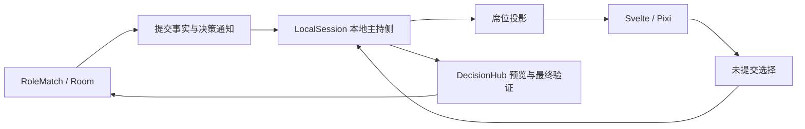

# 16 · 正式规则客户端与本地单机

更新：2026-10-17。主入口已从 P0 演示状态替换为正式 RoleMatch，浏览器可通过实际界面从开局走到身份胜负。默认标准＋EX 为 32 种牌、108 张实体牌，另可选择机制练习（见 [23 · 两件剑与标准牌组](23-swords-standard-deck.md)）。当前可选二十五名标准武将，AI 席位可保留循环预设或统一指定武将；目录与主动技能边界见 [27](27-generals-active-skills.md)，弃置与新增武将见 [28](28-discard-martial-generals.md)，魏将与判定/回合效果见 [29](29-wei-judgment-effects.md)，谋士与私有牌池见 [30](30-strategists-private-pools.md)。

默认固定人类控制甲席，其余角色使用基础 AI，不再交接设备。手动多席操作保留为内容调试选项。Android 构建与验收等桌面版完成之后开展。

## 所有权与数据流

[LocalSession](../src/app/offline/session.ts) 持有执行者、查看许可、订阅与输入转发。[GameView](../src/core/view/game.ts) 只有展示数据，不携带 World、原始历史 detail 或执行闭包。组件不导入规则模块，也不计算杀的距离、用牌次数、桃的目标等规则。

主控席位由主持侧固定，基础 AI 只拿到独立的信息受限观察，通过同一 DecisionHub 预览与提交。AI 私有请求不会进入人类视图；`automated` 只标识当前等待的角色，`paused` 标识主持侧暂停状态。策略与调度边界见 [26](26-basic-ai.md)。

[投影](../src/app/offline/projection.ts) 显示公共体力、性别、存活、手牌数量、装备与技能；身份只显示主公、当前本人、已死亡角色，终局揭示全表。单机视图只包含甲席手牌；手动演练只包含当前确认席位的手牌。其他人的牌不通过隐藏 DOM 保存。

日志只解释已明确公开的事实：摸牌数量、公开用牌/响应、体力变化、弃牌数量、死亡和胜负。原始洗牌顺序、起手内容和选择细节不透传。最近用牌保存语义牌快照，处理状态只追踪已宣告公开的材料；不能把任意 processing 区域都当作公开牌。

Journal 按提交、决策开放/关闭和故障异步通知，避免在提交中执行组件代码。订阅释放后不再调用观察者；Room 的权威执行不等待动画、帧率或视图更新。

## 固定主控与手动演练

单机自动确认 seat-ready 并控制非主控角色。自己的身份、手牌与右下席位不因其他角色出牌、响应或救援而切换；人类不能代答 AI 请求。暂停和后台事件会藏牌、撤销 AI 定时任务；恢复后明确点击继续。已经提交的规则结算正常善后，在下一次决策处等待。

勾选“手动演练（内容调试）”时，每回合的 seat-ready 需要本人确认。响应或救援切换操作者时，也先撤销上一席位许可：投影手牌为空、私有决策为空，清除已选材料、目标和详情，再显示原生 dialog 交接遮罩。Esc 不能绕过交接。交接令牌匹配当前请求；旧令牌不能开启后来的请求。

手动演练的“隐藏手牌”和页面隐藏事件会撤销查看许可，恢复后重新确认。它们不移动牌、不消耗次数、不推进回合。演练模式的所有席位均由人操作；没有账户或联机控制。

## 决策与交互

| 执行侧决策    | 当前界面                                                                      |
| ------------- | ----------------------------------------------------------------------------- |
| play-action   | 选实体/转换牌或主动技能、明确确认；技能自行组织后续选择，取消表示结束出牌阶段 |
| card-response | 闪/决斗中的杀，可打出或放弃                                                   |
| use-card      | 固定用途用牌；救援桃与锦囊反制不需要手工目标                                  |
| cards-targets | 手牌/公开牌池/私有选项、多目标反馈、强制弃牌不可取消                          |
| invoke        | 发动 / 不发动                                                                 |
| trigger-order | 可读技能名按钮，回复稳定 ID                                                   |
| choose-option | 具名选项以可读按钮显示，回复稳定 ID                                           |
| arrange       | 有序分组、组内前后移动、上下限预览与最终确认；暂停隐藏私有内容                |
| 其他          | 明确显示尚无该类面板，不自动取消或伪造回复                                    |

`CardBook.inspectUse` 在执行侧生成目标部分选择反馈，最终确认完整复用 validateUse。选择未完成也能区别可选目标与不可选目标。切换单目标时可以替换已选者；换牌时只保留仍合法的目标；预览不支付。转换配方支持零/多材料数量，有序分组/排序专用面板已接入；任意参数表单和带角色额度的分配仍未实现，见 [37](37-arrangement-astrology.md)。

Svelte 的草稿可能是 Proxy，LocalSession 在输入边界把材料和目标复制为普通数组。不能把响应式草稿直接交给 structuredClone，也不能为方便 UI 放宽规则层的普通数据要求。已有回归场景使用代理数组验证这个边界。

[手牌](../src/client/panels/HandCard.svelte) 保留右键/触摸长按详情，滑动取消长按。大手牌通过容器内横向滚动访问；快捷键 1–9 选牌，Enter 确认，Esc 清除草稿。输入框、详情、动画模态和交接遮罩期间不截获游戏快捷键。

[布局](../src/client/table/layout.ts) 为 2–8 个席位计算唯一矩形；Pixi 绘制与 DOM 命中区域共用坐标。单机始终以甲席为焦点，暂停也保留位置；手动演练以当前确认角色为焦点，无查看许可时使用活动角色。本人固定右下；手牌左下、确认居中在上、技能邻近本人，牌堆右上、记录从左打开，区域契约见 [25](25-table-position.md)。可选、已选与不可选状态来自决策反馈。开局设置支持 2/4/6/8 人、标准/机制牌组和确定性种子；战场标题显示实际装配的牌组。真实角色性别来自武将；手动演练仍使用交替性别的机制角色。

参考本地 noname 的 [game.check](../noname/resources/app/noname/game/index.js)（约 6941 行）与 [十周年 UI checkTarget](../noname/resources/app/extension/十周年UI/extension.js)（约 3015 行）：分别更新牌、目标和确认状态，明显区分可选/已选。只吸收交互逻辑，没有导入其全局对象或源码。

## 验证证据

- [主持侧集成场景](../tests/scenarios/local-session.test.ts)：8 项，覆盖私有投影、交接授权、旧请求、真实杀/闪、转换、救援、强制弃牌、终局、释放订阅、隐藏与中止。
- 窗口次数批验收时，规则/主持侧场景共 728 项，另有 7 项多席位布局场景，总计 735 项；最新验证以 [STATUS](STATUS.md) 为准。本批新增 [36 项窗口次数与组合](../tests/scenarios/occurrences.test.ts)，见 [38](38-window-occurrences.md)；此前新增 [34 项排序与诸葛亮场景](../tests/scenarios/astrology.test.ts)，见 [37](37-arrangement-astrology.md)；此前新增 [27 项目标分层反例](../tests/scenarios/target-stages.test.ts)，见 [36](36-target-stages.md)；此前新增 [38 项响应限制/具名选择与三将](../tests/scenarios/intrigue.test.ts)；此前 [36 项目标宣告/响应要求与谋将](../tests/scenarios/tacticians.test.ts)；此前 [35 项回复/活动查询与吴将](../tests/scenarios/wu-generals.test.ts)；此前 [35 项交牌/供牌/救援](../tests/scenarios/benevolence.test.ts)；此前 [38 项曹操/张辽与阶段替代](../tests/scenarios/commanders.test.ts)；此前 [27 项改判/私有池与谋士](../tests/scenarios/strategists.test.ts)、[24 项魏将与语义边界](../tests/scenarios/wei-generals.test.ts)、 [14 项弃置场景](../tests/scenarios/discard.test.ts) 与 [8 项武将扩展](../tests/scenarios/martial-generals.test.ts)；既有 [14 项武将/主动场景](../tests/scenarios/active-skills.test.ts) 和 [12 项基础 AI 场景](../tests/scenarios/basic-agent.test.ts)；原有 8 项 P0 演示/选择测试已移除，当前覆盖使用正式规则。
- [浏览器场景](../tests/browser/client.spec.ts)：桌面与 Pixel 7 触屏配置合计 134 项。使用生产构建和 Tauri 实际 CSP，检查 console/pageerror。本批新增 2 项验证许褚 AI 两点真实伤害与郭嘉逐次遗计；此前 4 项验证观星两组排序、暂停/恢复与后续真实摸牌，以及 AI 观星的私有边界；此前 10 项验证铁骑、英姿/反间、本人猜花色/暗选、有序离间与闭月；此前 8 项验证集智、AI 连续两闪、国色、流离；此前 8 项验证制衡、克己跳弃牌、连营及谦逊说明、吴 AI 桃触发救援；此前 8 项验证仁德交牌、激将 AI 供杀、青囊费用治疗和急救真实救援；此前 8 项验证突袭暗选/取消、奸雄取牌和护驾实际 AI 供闪；此前 6 项验证鬼才、天妒、遗计私有池/暂停/分批交牌；此前 6 项验证裸衣接受/拒绝、洛神取黑牌/停止；此前 4 项验证龙胆、被动技能说明与快捷键隔离；原有 4 项验证选黄盖/苦肉与孙尚香/结姻；另保留固定甲席、暂停/后台/继续、人类加 AI 对局至胜负场景。
- 两种浏览器配置分别使用默认单机与手动演练，通过真实界面运行两人身份局到胜负并重新开局。手动演练另覆盖无懈、万箭、五谷、顺手、装备替换、丈八转换、乐不思蜀判定/跳阶段、闪电传递、八卦阵供闪、青釭剑破盾，以及借刀的取消/交武器/用杀、青龙追杀、贯石斧突破、方天三目标与麒麟弓弃坐骑。这些指定分支使用脚本输入，与 AI 自主策略的验证分开。
- 额外覆盖八人席位边界、横屏 915×412、纵屏 390×844、长按详情、后台事件模拟、1/8 实例 Spine 播放和暂停继续。
- 两件剑另覆盖双股剑弃手牌/摸牌/拒绝、寒冰剑防伤与连续暗选/拒绝；两人至胜负场景使用默认标准＋EX 牌组，机制场景显式选择 288 张练习牌组。
- 类型 0 errors / 0 warnings，lint、格式、本地文档链接与生产构建通过。

截图位于 `.artifacts/ui/`，浏览器报告为 `.artifacts/validation/browser.json`；规则报告为 `.artifacts/validation/scenarios.json`。后台事件测试只证明客户端处理该事件，不代替 Android 系统前后台验收。

当前 Windows Debug/Release 均已构建并在实际 WebView2 中运行。手动演练验证四人局的装备替换、乐不思蜀、八卦、借刀、青龙、贯石斧、方天、麒麟弓、双股剑与寒冰剑；另验证正式选黄盖与苦肉的真实失去体力和摸牌、赵云龙胆与技能说明弹窗、许褚裸衣少摸一张与甄姬洛神取得黑牌/主动停止、司马懿鬼才、郭嘉天妒和遗计私有池/暂停藏牌/分批交牌；默认单机以人类甲席加 AI 乙席完成标准＋EX 两人身份局，验证固定视角、无交接、暂停藏牌与继续，再运行 8 实例 Spine；console errors 为空。成功使用无懈另有浏览器场景，真实救援与三层 AI 无懈由规则/主持侧场景验证。链接器仍有一条 import library 提示性 warning。WebView2 版本、记录与 exe SHA-256 在 `.artifacts/ui/native-smoke-debug.json` 和 `native-smoke-release.json`，截图按构建类型区分。

可运行练习版为 `.artifacts/builds/sgs-ng-0.1.0-local-client-windows-x64.zip`；当前归档成员为 exe、运行说明、Spine 许可和 harbor.sgs.mjs。归档内 exe 与模块的 SHA-256 已与实际运行的 Release 核对，清单为 `.artifacts/builds/local-client-manifest.json`；内容导入/持久保存见 [47](47-local-content-modules.md) / [48](48-content-persistence.md)，最新构建验证统一见 [STATUS](STATUS.md)。旧 P0 包保留，当前 Android 包仍为 P0。

额外回合队列、阶段计划和连续手动投影已接入（见 [24](24-extra-turns.md)）；尚无授予额外回合的真实武将。后续需要补齐完整武将与复杂技能，再完成 Android 真机验收、信息记忆语义、完整日志/录像与长局性能检查。Demo 已有基础 AI，完整智能托管与联机继续后置。
