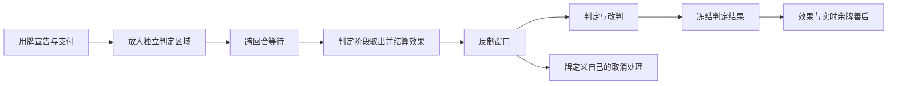

# 19 · 判定、改判与延时牌身份

日期：2026-10-17。新增乐不思蜀、闪电，练习牌组达到 22 种。完整标准包仍待继续，当前边界与实际验证见 [STATUS](STATUS.md)。

## 分开宣告、放置和生效



延时牌安装时仍走正常用牌、目标和支付管线，但标准无懈只在判定阶段的效果开始时征询。普通技能仍可明确取消安装效果。不能用“所有锦囊一律同一时点无懈”的分支混淆两个阶段。

[CardBook.resolveDelayed](../src/rules/cards/book.ts) 复用逐效果结算与 effectStarting 窗口，stage 明确为 delayed。它保留原 UseId，生成当前结算独有的 EffectId，不再支付、发一次 card.used 或重新确认目标。安装与后来生效都有各自事实，不能当成第二次使用该牌。来源角色死亡或转化技能消失，不抹掉已宣告的牌。

## 普通函数中的判定

[judge](../src/rules/cards/judge.ts) 接受 player、reason 和普通同步 match 函数。它拥有独立 Lifetime、处理区与当前判定牌面，返回 FlowResult 中的 judged/unavailable 和匹配结果。判定牌堆不足时只洗弃牌，不借用其他处理区，也不伪造一张牌。

```ts
const result = await judge(ctx, book, {
  player: target,
  reason: 'standard:indulgence',
  match: (_ctx, card) => card.suit === 'heart',
});
```

判定公开、牌面设置和移动同次提交，之后开放 judgmentRevealed、judgmentRetrial。match 在纯查询守卫内运行。目标死亡或终局发生后，不再生成匹配效果，但已经公开的牌仍执行正常善后。

后续 [58](58-judgment-pending-windows.md) 已补齐同一待决窗口内的持续资格：候选后效令判定者死亡或终局时，剩余候选立即收束，不只在两个窗口之间检查。已提交改判和材料交换不回滚；封口后的公共完成窗口仍保留真实结果。

判定牌面与实体牌的实时位置分开。牌被提前取得后，原结果不会凭空消失；后续改判仍可明确替换它，不能强行从取得者手中再次移走旧牌。当前牌面查询及封口边界见 [50](50-card-faces.md)：judge 显式接收同一局 CardBook，封口前按被判定者重读过滤，封口后保留不可变结果。

## 改判不是随意赋值

`judgment.replace(ctx, { card, from, reason, previousTo? })` 明确新牌原区域与旧牌去向，默认旧牌弃置。新旧牌移动、当前判定牌面和改判事实同次提交；移牌后效立即读到新的牌面。previousTo 可以是原手牌区，支持原子交换。

原区域失效返回 unavailable，不支付。非法移动拒绝整个提交；代码错误仍冻结本局，不回滚已提交的其他结算。连续改判使用同一个句柄；嵌套判定各有独立句柄和处理区，不覆盖外层。

结果在 judgmentFinished 前封口。该窗口可取得仍在处理区的最终判定牌，但不能再改判。过期、跨 World 或不在祖先路径内的句柄不能编辑；保留句柄读取时得到已封口牌面。本篇最初尚未提供判定过滤；后续 [50](50-card-faces.md) 已接入纯牌面查询。

`judge` 后续加入可选 `onResult(ctx, result)`，在公共结束窗口后、处理区善后前运行。洛神用它在普通函数循环中取得黑色判定牌，避免同原因嵌套判定被临时全局监听器误收；完整契约与反例见 [29](29-wei-judgment-effects.md)。

## 延时牌的逻辑身份

[placeDelayed](../src/rules/cards/delayed.ts) 为每个实例创建独立持久 judgment 区域，用普通 World state 保存宣告的 CardUseRef。区域、材料和元数据同次提交。没有把转化后的名称覆盖回实体牌，也没有把函数、Promise 或悬挂上下文存进 World。

因此一张杀可以作为乐不思蜀的材料，判定区仍显示乐不思蜀；被获得后回到手中的是实际材料牌。零材料牌也有独立实例，多材料牌只占一个逻辑判定牌身份。放置前必须仍完整持有本次材料，不能悄悄安装一个材料已被取走的残缺实例。

`delayedCards` 从区域与元数据派生当前实例；同名牌默认不重复放在同一角色处。标准安装使用 placeDelayed；直接把实体牌移入一个普通判定区域不会自动猜测并创建逻辑身份。

`moveDelayed(ctx, id, to)` 整体处置当前材料并同次移除身份。顺手/拆桥的选择区分普通实体牌与逻辑延时牌；后者只显示一个选项，通过 moveDelayed 取得或弃置全部材料。零材料实例同样可以被移除。

直接拆走部分材料会使实例失效。cardsMoved 的 attachments 组在普通后效前关闭破损实例、处置余牌；埋葬还会关闭零材料实例。这里管理的是牌的持有身份，没有另存一套技能授予列表。

## 判定阶段与后续阶段意图

默认判定阶段开始时快照已有实例，后放先结算。每个实例执行前再检查是否仍在当前角色处。结算中移入的新实例留到下次，闪电绕回自己不会在同一阶段无限重复；跳过判定阶段也不会消耗原实例。

乐不思蜀判定不为红桃时，调用 `turn.skipNext(ctx, 'play', reason)`。这是当前回合内对下一次指定阶段的意图：在该阶段的 phaseBefore 前消费，与跳过状态同次提交，到回合结束仍未消费则到期。额外同名阶段不会被同一个意图反复跳过；重复预定不会累积成不明队列。独立 runPhase 没有关联 Turn 时，不产生跨回合跳过。

闪电黑桃 2–9 造成无来源的 3 点雷电伤害；不命中或效果被无懈时，按实际座次寻找下一合法角色，跳过死亡、已有同名牌或禁止目标。若没有可放置者则善后弃置。取消后的处理属于牌定义的普通函数，不能把所有延时牌的取消统一硬编码为弃牌。

## 提交与客户端

moveCards 的领域声明可携带非 move Change，组成同一次提交。所有移动仍列在 moves 中；只有实际有移牌时才开放 cardsMoved。零材料放置/移除提交区域和状态，不捏造移动。

客户端只投影公开判定区、牌面、判定/改判结果和跳阶段日志。语义延时牌与底层材料分开显示；公共牌面操作只查看详情，真正选择仍使用执行侧候选。脚本化浏览器与原生检查不直接修改 World。

[判定场景](../tests/scenarios/judge.test.ts) 11 项，[延时牌场景](../tests/scenarios/delayed.test.ts) 21 项，覆盖连续改判、交换、取得、嵌套、终局、反制、跳阶段、零/多材料、转化来源消失、破损清理、埋葬与事实重建。平台结果与当前总数统一见 STATUS。

参考本地 FreeKill 的 [乐不思蜀](../freekill/packages/standard_cards/pkg/skills/indulgence.lua)、[闪电](../freekill/packages/standard_cards/pkg/skills/lightning.lua) 和 [延时牌放置](../freekill/ltk/server/events/usecard.lua)。八卦阵、其余装备、标准武将和完整牌组仍待继续；AI、联机继续后置。
