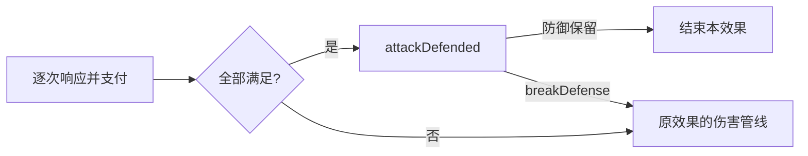

# 武器、防御结果与动态目标数

本篇说明青龙偃月刀、贯石斧、方天画戟与麒麟弓的后效和装备来源。双股剑、寒冰剑与实体牌表见 [23](23-swords-standard-deck.md)，当前验证以 [STATUS](STATUS.md) 为准。

## 防御成功不是牌被取消

[攻击流程](../src/rules/combat/attack.ts) 统一处理杀与群体攻击牌的逐次响应，以 `{ name, purpose }` 明确要求使用还是打出。全部所需响应满足后，才打开 `attackDefended`；杀要求使用两张闪而只使用一张时，不产生防御成功窗口。闪的完整使用/打出、委托与后效见 [55](55-response-purpose.md)。防具在效果开始前取消黑杀，也不冒充一次成功闪避。



`DefenseDraft` 提供当前 EffectRef、已完成使用/打出的只读响应快照、`broken`、`reason` 和 `breakDefense(reason)`。突破保留所有已提交的响应活动，只改变这一次攻击的防御结果；封口后和纯查询中禁止修改。不同目标、嵌套用牌各有自己的草案。

`attack.defended`、`attack.defense-broken` 和 `attack.finished` 保存普通数据，不保存执行句柄。最终 `AttackResult.kind` 是 defended / undefended / unavailable；undefended 仍可能被伤害技能防止，实际结果看 `damage.kind`，不能把未防御直接当成已扣体力。

## 四件武器

| 武器       | 实现与边界                                                                                                                                                                |
| ---------- | ------------------------------------------------------------------------------------------------------------------------------------------------------------------------- |
| 青龙偃月刀 | 只监听自己的杀被防御，使用 `askUse` 对原目标追加真正的杀。新 UseId、材料、处理区和防御结果独立；原杀保留已防御状态。可以继续追杀或取消，也支持武圣等转换。                |
| 贯石斧     | 防御成功后选择两张其他手牌/装备，统一支付再 `breakDefense`。不能用斧本身、原杀处理材料或对方已经打出的闪作费用。支付后失去武器/死亡不撤销已宣告突破；后续伤害仍可被防止。 |
| 方天画戟   | 杀材料包含非空的全部手牌，且不包含戟本身时，追加两个目标上限。单张最后手牌和多材料用尽手牌共用查询；空手零材料不算。声明后的目标不因手牌已经支付而消失。                  |
| 麒麟弓     | 在伤害来源侧窗口可选择受伤角色一张进攻/防御坐骑，发动后再检查所选实体仍在该角色装备区。不会追索已经被别人拿走的坐骑；弓在发动后离场不撤销已发动效果。                     |

麒麟弓处于 `damageCausing`：若随后目标侧防止伤害，已经完成的弃置仍保留；在它之前已经防止或归零的伤害不发动。当前没有连环/伤害转移，后续实现这些规则时还需明确直接牌伤害与派生伤害的归属，不能用当前测试替代该验收。

## 局部用牌参数与纯查询

青龙用 `{ kind: 'effect', ignoreDistance: true }` 表示追加杀忽略距离，继续使用 effect 时机的阶段次数规则。这个参数仅属于本次用牌，并进入 TimingSnapshot。它不会修改玩家的全局距离或放宽目标禁止；之后普通用牌恢复普通检查。

`book.withinDistance(ctx, request, target, maximum)` 统一解释该距离参数；杀与顺手的标准目标条件已使用它。其他扩展牌应在自己的距离条件中显式采用该助手。`askUse.available` 是额外的纯资格门，用于来源离场、请求关闭等情况的最终重查。

`cardQueries.extraTargets` 按非负整数加法组合，`book.targetCount` 在原数量上增加最大值，最小值不变。自动目标牌继续不接受手工目标。候选反馈和最终验证共同调用它，UI 只显示与提交选择。

## 内容作者取得服务

装备能力是静态 SkillDefinition；需要牌目录或完整用牌服务时，在回调里用 `rulesOf(ctx)`：

```ts
equipmentCard({
  id: 'my:weapon',
  label: '示例武器',
  slot: 'weapon',
  range: 3,
  skill: {
    id: 'my:weapon-ability',
    name: '示例武器',
    triggers: [
      /* 回调中 rulesOf(ctx).askUse / cardDef(ctx, name) */
    ],
  },
});
```

CardBook 从权威装备位置派生角色绑定；没有模块级可变 book，也没有新增 World 中的授予副本。

`SkillHandle.name` 是定义派生的显示名。技能发动的费用宣告携带可读 label，客户端不再把实现 ID 当成名称。贯石斧、麒麟弓的可选选择显示“不发动”；联合选择可通过 `decision(player, prompt, { optional: true, cancelLabel })` 指定取消文字，借刀复用它显示“取消用牌”。

## 验证入口

[武器场景](../tests/scenarios/weapons.test.ts)覆盖支付、伤害防止、来源离场或死亡、连续追杀、距离变化、转换材料、坐骑与事实重建；[客户端场景](../tests/browser/client.spec.ts)验证实际选择流程。当前计数、原生运行和交付只维护在 STATUS，检查方法见[标准验收入口](53-standard-semantics.md#行为清单与检查)。

规则参考本地 FreeKill 的 [blade](../../freekill/packages/standard_cards/pkg/skills/blade.lua)、[axe](../../freekill/packages/standard_cards/pkg/skills/axe.lua)、[halberd](../../freekill/packages/standard_cards/pkg/skills/halberd.lua)、[kylin_bow](../../freekill/packages/standard_cards/pkg/skills/kylin_bow.lua)。没有兼容桥或旧时点别名。
