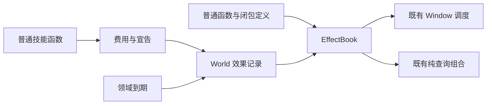

# 56 · 独立效果与普通作者代码

更新：2026-11-03。每局独立效果目录通过普通源码组合，标准裸衣使用相同入口。这里表示持续规则效果，与一次用牌的 CardEffect 分开；结束持续效果不自动撤回已经宣告的牌效果。复用 World 的普通状态、Window 调度和现有纯查询，没有增加新的执行内核或技能 DSL。

## 来源技能、效果身份和角色归属分别表达



[EffectBook](../src/rules/effects/effects.ts) 通过 `book.effects` 或 `skills.effects` 使用。SkillBook 挂接 Room 时同时挂接效果来源，释放时解除；同一 World 只有一份效果目录。定义在装配期登记，挂接后固定；实例在局内创建、更新和结束。

EffectRecord 保存 id、type、owner、origin、scopeId、data，都是普通不可变数据。owner 是候选的行动序归属，可为 null，不隐含角色存活、技能持有或来源生存。origin 是作者提供的来源快照，不是可重新发动旧技能的资格。实际技能授予仍留在 World.skills，独立效果不会伪造一条技能实例。

EffectHandle.current(world) 返回当前挂接中的实例记录；实例结束、外局或旧挂接返回 null。角色死亡、技能失效或撤销是否结束效果，由普通规则代码明确决定。守约示例保留宣告者死亡后的效果，在受益者死亡时主动结束；裸衣则明确要求原角色仍存活，并且当前执行的回合与记录一致。

## 定义和使用

独立效果直接用普通对象声明 id、name、纯 accepts、普通 create 函数和可选 onEnd，使用 `satisfies EffectDefinition<Data>` 获得类型提示。createContent / EffectBook.register 固定声明并保留原接收者；需要主动提前规范化时仍可使用 defineEffect。

create 取得类型化句柄，返回普通 triggers/modifiers 列表；作者可以用条件、循环和闭包构造行为，用与技能相同的 `on(Event.timing, spec)` / effectModify 连接现有时点和查询；回调为 `(ctx, event, self, …)`，效果中默认自动排序且不询问、不宣告，类型化 self 保留在 create 的闭包中。结束后效使用 `onEnd(ctx, { before, reason })`，before 保留声明的数据类型。自定义 bind 也必须同步；候选收集与执行前重绑都会在读取绑定结果前检查，不会把 Promise 当作无触发或无身份。

accepts / create / onEnd 支持普通方法及原型方法，装配固定入口并保留原接收者，不冻结作者对象。defineEffect 重复接收本入口已固定的声明时直接复用；外部原对象不作缓存，方法内部读取的可变数据仍由开发者管理。实例创建继续核对登记工厂，核对使用绑定前的函数身份，避免方法绑定把同一实现误认作不同声明；同名但不同工厂仍被拒绝。

句柄字段始终是本次绑定的不可变快照。行为工厂与自定义 bind 在候选执行前读取最新记录重新绑定；当前查询也按当前记录构造行为。自定义 bind 返回的 Trigger 可以使用原型字段、方法和私有字段；目录补充标签时保留其原接收者。候选的身份、组、座次与次数仍在入场时固定。

| 读取方式                  | 明确含义                                                                   |
| ------------------------- | -------------------------------------------------------------------------- |
| self.data                 | 本次绑定时的数据；更新、结束和嵌套调用都不改写它                           |
| self.current(ctx.world)   | 此刻仍存在的记录或 null；保留返回值就得到一次读取快照                      |
| await update / end 的结果 | 本次实际更新后的记录 / 实际移除的记录；未发生操作时为 null，后效不倒改结果 |

例如绑定时为 8，回调内更新到 12：self.data 一直为 8，current 读到 12；结束后 current 为 null，end 返回数据为 12 的记录。onEnd.before 同样指向结束提交前的记录。嵌套回调各有自己的绑定快照。作者按所需时点明确读取，不再依赖字段隐式切换，也不需要为了结束后使用数据手动绕过旧值回退。

跨 await 后若需当前值，重新调用 current；若需按结束时数据结算，使用 await self.end(ctx, reason) 的返回记录。update / end 显式传入当前 Context。行为工厂、条件、次数和查询保持纯；异步后续放在 run / onEnd 中。

```ts
const record = await book.effects.add(ctx, covenant, {
  owner: target,
  origin: { actor: self.owner, skill: self.skill, instance: self.id },
  data: { target, remaining: 1 },
});

await book.effects.update(ctx, record.id, { target, remaining: 0 });
await book.effects.end(ctx, record.id, 'covenant:finished');
```

add 产生独立身份并提交 effect.added；update 保留身份，提交 before/after 并开放 effectChanged；end 幂等移除实例，随后提交 effect.ended、开放 effectEnded，再执行定义的 onEnd，返回本次移除前的记录；再次结束返回 null。所有流程都需 await，中止默认向外传播，不把失败解释成另一个领域结果。

返回记录是本次提交快照，后效可以再次更新或结束实例；当前实例通过 current 或 instances 显式读取。

prepare / add / update 先在纯查询内固定整份记录，再校验其中实际保存的 data；accepts 取得的同一份只读数据进入 World。原始 getter 不会在校验后再次读取，origin 与 data 的别名保持，复制过程也不能重入规则写操作。原始输入仍由调用者持有，后续修改不会改变已固定的记录。

查询仍经 SkillBook.query 的原组合函数，undefined 表示不贡献，null 等值由查询自己定义。效果贡献不借用技能拥有者的默认存活判断；需要这一条件时，作者在查询中直接检查角色。

## 生存期和结束

add / prepare 可携带当前祖先领域的 lifetime。跨局、非祖先和已关闭领域拒绝；未传 lifetime 的效果可跨创建 Flow、阶段和回合存在，直到规则明确结束。

领域到期先同步移除自己的全部状态，再执行后效。LifetimeEnd 现在同时保留 statesBefore 与原有状态 ID、skillsBefore；效果库据此生成到期结束事实，不维护另一份可漂移的实例注册表。结束窗口和 onEnd 看见的查询资格已经撤销，内外层领域及独立实例分别保留。

同批到期的每个实例在自己的恢复边界中执行结束窗口与 onEnd：一项后效局部中止，其余项仍生成结束事实并结算；原领域本体的中止原因仍在善后之后向外传播。显式调用 end 的中止继续向调用者传播。代码故障或整局关闭不属于局部恢复，余项后效停止，已提交的批量移除不回滚。

正常领域结束和局部中止均执行领域善后。整局 finish / abort / fault 会释放执行侧登记，令旧句柄失效；它们不会为仍保留在已提交 World 中的独立效果伪造逐项结束事实，也不承诺故障之后继续异步规则回调。

旧挂接的句柄和卸载函数只属于那一次登记，不能结束新挂接中的实例或删除新登记的 World 所属关系。纯查询不能创建、更新或结束效果，也不能借行为工厂或贡献函数写规则状态。

## 同一窗口、动态行为与原子宣告

候选的身份、组、行动序位置和有限次数在入场时固定。执行前按最新数据重新绑定当前行为：被移除的触发不执行，闭包中的数据不沿用过期值；增加次数不会回补旧候选。正在运行的普通函数不因结束效果而自动回滚已经做出的结算。

窗口中新增实例或新触发不进入既有候选，从下一个时点开始参与。

需要与费用同次宣告时用 prepare：

```ts
const prepared = await book.effects.prepare(ctx, definition, input);
const paid = await pay(ctx, {
  actor,
  reason,
  legal: live,
  changes: [prepared.change],
  declaration: { effect: prepared.record },
});
```

prepare 返回普通记录与 Change，交给调用方在 legal 中重查费用、领域与资格后提交；跨 await 的声明也由调用方重新验证。ctx.commit 提交显式 Change，不隐式重新执行验证函数。直接 add 有自己的添加窗口；与费用合并时，效果身份保存在支付宣告中，提交后效立即可以查询新效果。

## 裸衣与跨回合守约

[裸衣](../src/content/standard/generals/) 现在声明独立的 standard:luoyi-effect。费用与效果状态同次提交；同角色、同回合只保留一份加成，重复摸牌仍可以少摸但不叠加伤害。失去原技能不撤回效果，嵌套其他回合不借用外层加成，到期自动移除。原来专用的状态扫描、Provider 和伪技能句柄已删除，原有二十六项魏将场景继续验证实际行为。

[守约示例](../examples/effects/covenant.ts) 用普通代码组合：受益者手牌上限加一、下次正伤害在防御窗口减一并消耗次数、受益者回合结束撤销并摸一张牌，受益者死亡则撤销且不摸牌。宣告者死亡后仍持续。这是源码/规则场景示例；标准裸衣由现有正式界面与基础 AI 使用。

普通 `ContentDefinition` 直接声明 `effects: [covenant]`，通过 `createContent(standard, { effects: [covenant] })` 组合；重复定义在装配期拒绝，每局创建自己的目录。效果不必通过技能工厂的登记副作用安装，也没有命名空间、包解析或专用文件格式要求。普通 import 共享实际触发声明、Query 和事件身份，所有内容复用同一效果库。

## 验证与边界

[独立效果场景](../tests/scenarios/independent-effects.test.ts)、[源码组合场景](../tests/scenarios/effect-content.test.ts) 和 [绑定数据场景](../tests/scenarios/effect-binding-snapshots.test.ts) 覆盖来源失去/死亡、更新/移除、有限次数、同窗与嵌套重绑、旧挂接失效、纯查询、结束后效及事实重建。绑定数据场景同时验证“按绑定值摸 8 张”与“按结束结果摸 12 张”。

当前完整检查和平台边界只见 [STATUS](STATUS.md)。记录重建与重新加载定义可以恢复效果解释能力，不能恢复暂停中的协程、决策或完整对局存档。旧的活动 data 回退语义与布尔 end 返回值已被替换，不保留兼容分支。
