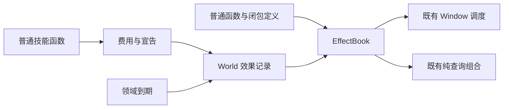

# 56 · 独立效果与普通作者代码

更新：2026-10-18。已接入每局独立效果目录，并将标准裸衣迁出专用 Provider。这里表示持续规则效果，与一次用牌的 CardEffect 分开；结束持续效果不自动撤回已经宣告的牌效果。复用 World 的普通状态、Window 调度和现有纯查询，没有增加新的执行内核或技能 DSL。

## 来源技能、效果身份和角色归属分别表达



[EffectBook](../src/rules/effects/effects.ts) 通过 `book.effects` 或 `skills.effects` 使用。SkillBook 挂接 Room 时同时挂接效果来源，释放时解除；同一 World 只有一份效果目录。定义在装配期登记，挂接后固定；实例在局内创建、更新和结束。

EffectRecord 保存 id、type、owner、origin、scopeId、data，都是普通不可变数据。owner 是候选的行动序归属，可为 null，不隐含角色存活、技能持有或来源生存。origin 是作者提供的来源快照，不是可重新发动旧技能的资格。实际技能授予仍留在 World.skills，独立效果不会伪造一条技能实例。

实例存在与执行挂接有效时，EffectHandle.active 才为真。角色死亡、技能失效或撤销是否结束效果，由普通规则代码明确决定。守约示例保留宣告者死亡后的效果，在受益者死亡时主动结束；裸衣则明确要求原角色仍存活，并且当前执行的回合与记录一致。

## 定义和使用

`defineEffect<Data>` 接受 id、name、纯 accepts、普通 create 函数和可选 onEnd。create 取得类型化句柄，返回普通 triggers/modifiers 列表；作者可以用条件、循环和闭包构造行为，用 effectOn / effectModify 连接现有窗口和查询。

句柄的 data 在实例存在时读取最新数据；结束后的普通后续保留本次绑定快照。update / end 显式传入当前 Context。行为工厂、条件、次数和查询必须保持纯；真正的异步规则后续放在 run / onEnd 中。

```ts
const record = ctx.unwrap(
  await book.effects.add(ctx, covenant, {
    owner: target,
    origin: { actor: self.owner, skill: self.skill, instance: self.id },
    data: { target, remaining: 1 },
  }),
);

ctx.unwrap(await book.effects.update(ctx, record.id, { target, remaining: 0 }));
ctx.unwrap(await book.effects.end(ctx, record.id, 'my-package:finished'));
```

add 产生独立身份并提交 effect.added；update 保留身份，提交 before/after 并开放 effectChanged；end 幂等移除实例，随后提交 effect.ended、开放 effectEnded，再执行定义的 onEnd。所有流程都需 await，中止用 unwrap 延续，不把失败解释成另一个领域结果。

返回记录是本次提交快照，后效可以再次更新或结束实例；持续资格通过 active 或当前 instances 读取。

查询仍经 SkillBook.query 的原组合函数，undefined 表示不贡献，null 等值由查询自己定义。效果贡献不借用技能拥有者的默认存活判断；需要这一条件时，作者在查询中直接检查角色。普通自定义 EffectTrigger 绑定也受支持，显式入窗不要求 ID 采用某种可解析格式。

## 生存期和结束

add / prepare 可携带当前祖先领域的 lifetime。跨局、非祖先和已关闭领域拒绝；未传 lifetime 的效果可跨创建 Flow、阶段和回合存在，直到规则明确结束。

领域到期先同步移除自己的全部状态，再执行后效。LifetimeEnd 现在同时保留 statesBefore 与原有状态 ID、skillsBefore；效果库据此生成到期结束事实，不维护另一份可漂移的实例注册表。结束窗口和 onEnd 看见的查询资格已经撤销，内外层领域及独立实例分别保留。

正常领域结束和局部中止均执行领域善后。整局 finish / abort / fault 会释放执行侧登记，令旧句柄失效；它们不会为仍保留在已提交 World 中的独立效果伪造逐项结束事实，也不承诺故障之后继续异步规则回调。

旧挂接的句柄和卸载函数只属于那一次登记，不能结束新挂接中的实例或删除新登记的 World 所属关系。纯查询不能创建、更新或结束效果，也不能借行为工厂或贡献函数写规则状态。

## 同一窗口、动态行为与原子宣告

候选的身份、组、行动序位置和有限次数在入场时固定。执行前按最新数据重新绑定当前行为：被移除的触发不执行，闭包中的数据不沿用过期值；增加次数不会回补旧候选。正在运行的普通函数不因结束效果而自动回滚已经做出的结算。

窗口中新增实例或新触发不自动进入既有候选；可通过 `effects.include(ctx, windowRef, ids?)` 显式加入。已经处理的身份、已经过去的位置和来源登记仍遵守 [51](51-window-admission.md)，不重复创建一个窗口。

需要与费用同次宣告时用 prepare：

```ts
const prepared = ctx.unwrap(await book.effects.prepare(ctx, definition, input));
const paid = ctx.unwrap(
  await pay(ctx, {
    actor,
    cards: [],
    to: 'discard',
    reason,
    legal: live,
    changes: [prepared.change],
    declaration: { effect: prepared.record },
  }),
);
```

prepare 返回普通记录与 Change，交给调用方在 legal 中重查费用、领域与资格后提交；跨 await 的声明也由调用方重新验证。ctx.commit 提交显式 Change，不隐式重新执行验证函数。直接 add 有自己的添加窗口；与费用合并时，效果身份保存在支付宣告中，提交后效立即可以查询新效果。

## 裸衣与跨回合守约

[裸衣](../src/content/standard/wei.ts) 现在声明独立的 standard:luoyi-effect。费用与效果状态同次提交；同角色、同回合只保留一份加成，重复摸牌仍可以少摸但不叠加伤害。失去原技能不撤回效果，嵌套其他回合不借用外层加成，到期自动移除。原来专用的状态扫描、Provider 和伪技能句柄已删除，原有二十六项魏将场景继续验证实际行为。

[守约示例](../examples/effects/covenant.ts) 用普通代码组合：受益者手牌上限加一、下次正伤害在防御窗口减一并消耗次数、受益者回合结束撤销并摸一张牌，受益者死亡则撤销且不摸牌。宣告者死亡后仍持续。这是源码/规则场景示例；标准裸衣由现有正式界面与基础 AI 使用。

普通内容包可声明 `effects: [covenant]`。包解析检查命名空间和重复定义，每局创建自己的目录；未选包不安装定义。外部 .sgs.mjs 同样使用宿主 effectOn、Query 和 Window 身份，真实编译/载入后验证修改上限与减伤，不打包第二套效果库。

## 验证与后续

本批新增 [36 项独立效果场景](../tests/scenarios/independent-effects.test.ts)、[7 项效果包场景](../tests/scenarios/effect-packages.test.ts) 和 [1 项外部模块场景](../tests/scenarios/content-modules.test.ts)。覆盖独立/全局实例、角色死亡、嵌套领域、原子费用、同窗更新/移除/接纳、有限次数、闭包重绑、普通自定义绑定、外局/旧挂接、纯查询、结束回调、登记失败和已提交事实重建。

动态行为的两个初版失败场景保存在 `.artifacts/validation/independent-effects-binding-before.json`；旧卸载登记失败场景为 `independent-effects-registration-before.json`。更早的 `independent-effects-boundaries.json` 包含两个测试夹具错误：无角色候选的位置、同步抛错的断言方式；不把它们算作已修复的规则缺陷。最终完整报告以 [STATUS](STATUS.md) 为准。

标准/演武更新为 0.1.14，渡口仍为 0.1.0 且精确依赖 standard@0.1.14。应用壳、默认标准 32 种牌/25 将/108 实体及演武 37 牌/29 将/五种牌组不变。记录重建加重新加载定义能恢复效果解释能力，仍不恢复暂停中的协程、决策或完整对局存档。

最终全部单元/行为 1266 项通过，其中规则/主持侧 1259 项从同次报告分类计数并记录哈希，不另算独立执行。桌面/触控浏览器 174 项一次通过，无跳过或重试通过；Windows Debug/Release 各通过 66 组实际 WebView2 检查及不同 PID 的内容重启恢复，控制台无错误。原生核对迁移后的裸衣实际增伤与逐次遗计，新复杂效果分支由规则/包/模块场景证明。类型、ESLint、Prettier、文档链接及两种原生构建通过，链接器保留一条 import library 提示性 warning。发布 ZIP 4,628,009 字节、精确四个成员，实际字节/哈希/依赖/清单与原生证明见 `.artifacts/validation/independent-effects-package-audit.json`；测试进程、端口及隔离目录已清理。

完整标准分支、复杂替代响应额度、更多复杂效果组合和作者资源交付仍需继续；没有以这层基础能力宣布完整离线版验收。默认固定人类甲席，其他基础 AI；Android 等桌面完成后开展，完整智能托管与联机后置。
