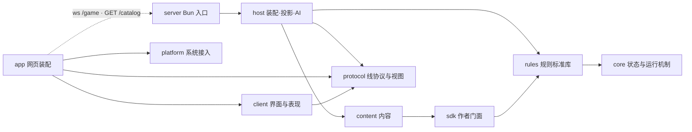

# 架构与结算契约

本文是模块、所有权与结算契约的唯一说明：前半讲模块与数据流，后半讲结算语义。作者 API 见 [AUTHORING](AUTHORING.md)，标准规则裁定见 [RULINGS](RULINGS.md)，完成情况见 [STATUS](STATUS.md)。每局只有一个权威规则执行实例；不引入服务拆分、ECS、消息中间件或依赖注入框架。

## 五个主要概念

| 概念     | 责任                                                                 | 不能混淆的边界                                   |
| -------- | -------------------------------------------------------------------- | ------------------------------------------------ |
| World    | 当前权威状态：角色、牌、区域、阶段、状态实例                         | 不存 UI 对象、Promise、函数或 Spine 实例         |
| Flow     | 一段可等待的结算过程，拥有父子因果、结果和作用域                     | 不等同于一个触发时点，也不要求把函数编译成状态机 |
| 时点     | `defineEvent` 声明的 timing；`ctx.window` 开放并等待所有触发处理完成 | 不是不等待订阅者的普通事件总线                   |
| Decision | 引擎暂停并请求玩家选择，具有稳定的输入输出与运行时验证               | 不等同于一个对话框，校验闭包无需序列化           |
| Fact     | 已经提交、不可被后来技能改写的语义记录                               | 不等同于草案、表现通知或函数调用栈               |

运行时只提供执行、窗口、选择、提交、作用域和记录机制；伤害、用牌、判定、死亡等由规则库编排。核心可以知道牌、角色、区域这些本游戏的基础结构，不追求“可运行任意桌游”的通用引擎。

## 依赖方向

箭头表示“左侧导入右侧”。前后端分离（P2）：**规则只在 Bun 主持端运行**。`host` 装配对局、投影、基础 AI 与会话，`server` 提供 HTTP / WebSocket；网页端（`main.ts`、`app`、`client`、`platform`）只含界面与素材，经 `protocol` 消费视图，单机与联机都走同一个 RemoteSession。核心不反向 import 内容。



`sdk` 是内容作者的唯一入口：按定义、时点、查询、动词与选择模型分组，再导出 core 与 rules 的实际对象（约 110 个值、130 个名字），不复制实现；测试与主持端直接引用规则模块。主持端启动时由 [load-content](../src/host/load-content.ts) 扫描 `src/content/<包>/package.ts` 与包内 `generals/*.ts`、`cards/*.ts`、`skills/*.ts`（一将、一牌、一技各一个文件；`package.ts` 只描述牌组与顺序）（Bun 直接 import 源码；桌面 Node 产物由 [prelink-content](../scripts/prelink-content.mjs) 预链接同一棵树），校验后按确定顺序组合；没有登记表、安装、依赖清单或编译器。对局不读取分发版本，也不将它们写入 World。[protocol](../src/protocol/index.ts) 是展示数据与线协议的唯一定义（纯数据，不依赖 core）。握手比较 `protocolHash`；主持端把扫描到的内容源码哈希 `contentHash` 随 hello 与 `/catalog` 发出。

网页端边界有三道检查：eslint 禁止网页端导入 core / rules / content / sdk / host / server / `assets.json`；[导入图测试](../tests/scenarios/web-boundary.test.ts) 从 `src/main.ts` 沿运行时导入走查；`pnpm build` 之后 [check-web-bundle](../scripts/check-web-bundle.mjs) 扫描 `dist` 脚本中的主持端标记（如规则报错文本）。大厅需要的武将、牌组与技能说明由主持端 `GET /catalog`（[catalog](../src/host/catalog.ts)）提供。

当前目录如下；不把尚未建立的接口或目录列为既有实现。

```text
src/
  core/
    model/           # 基础实体、区域、Change 与冻结数据
    state/           # World、同步提交、基础不变量
    runtime/         # Flow、时点（defineEvent / timing）、作用域、调度和随机源
    decisions/       # 选择会话、候选与回复验证
    history/         # 顺序事实、作用域查询、轨迹
  rules/
    turn/            # 回合序列（轮与额外回合）、阶段、跳过与插入
    cards/           # 使用、响应、目标、判定、牌移动
    combat/          # 伤害、护盾、回复、濒死和死亡
    characters/      # 武将、性别和势力
    costs/           # 支付、次数与同步宣告
    skills/          # 实例、触发、主动能力与具名查询
    state/           # 类型化局内标记（带技能的标记即持续效果）
    scopes/          # 领域生存期和到期善后
    game/            # 身份、胜负与模式装配
  sdk/               # 内容作者的唯一入口
  content/
    standard/        # generals/、skills/、cards/ 各一文件一定义，另有牌组
    workshop/        # 演武内容（同样的目录约定），用于机制边界
  protocol/          # 线协议与展示视图（纯数据；网页端只依赖这里）
  client/
    table/           # Pixi 战场、卡牌、角色和指示
    panels/          # Svelte 面板、说明、菜单和选择器
    interaction/     # 选择草稿与输入
    presentation/    # 音频、帧序列与独立 Spine 演示；完整表现时序后置
  platform/          # 浏览器/WebView 前后台观测
  app/               # 网页装配：App、RemoteSession、素材绑定
  host/              # 主持端：对局装配、投影、基础 AI、单机会话、联机房间、目录
  server/            # HTTP / WebSocket 主持进程（Bun 直接运行源码）
examples/content/    # 渡口、画阁等普通作者源码模块
tests/
  scenarios/         # 跨模块的真实机制反例
  fixtures/          # 小型牌堆、脚本化回答、指定种子
src-tauri/           # Tauri 桌面壳（Windows 主持子进程）
```

测试可与实现相邻；`tests/scenarios` 用于完整结算案例。格式化与静态检查只覆盖新项目文件。

## 内核入口

| 模块                                                                                      | 责任                                                           |
| ----------------------------------------------------------------------------------------- | -------------------------------------------------------------- |
| [World](../src/core/state/world.ts)、[immutable](../src/core/model/value.ts)              | 每局状态、原子变更准备、只读快照、实体牌唯一位置               |
| [Room / Context](../src/core/runtime/room.ts)、[Scope](../src/core/runtime/scope.ts)      | 串行执行、父子因果、中止传播、同步资源释放与故障冻结           |
| [defineEvent / timing](../src/core/runtime/event.ts)                                      | 类型化时点与具名顺序组；候选调度由 Room 负责                   |
| [DecisionHub](../src/core/decisions/hub.ts)                                               | 活跃请求、预览、token、最终验证、一次接纳与关闭                |
| [Journal](../src/core/history/journal.ts)、[rebuildWorld](../src/core/history/rebuild.ts) | 有序事实、原因链、历史查询与状态重建                           |
| [SDK](../src/sdk/index.ts)                                                                | 作者使用的实际类型和规则操作；用法见 [AUTHORING](AUTHORING.md) |

## 所有权

| 数据                             | 所有者              | 读取与修改方式                             |
| -------------------------------- | ------------------- | ------------------------------------------ |
| 角色体力、牌位置、阶段、技能状态 | 单个对局的 World    | 规则通过语义操作提交；内容拿只读视图       |
| 本次伤害数量、本次用牌目标计划   | 当前 Flow 草案      | 在允许的窗口内通过领域方法修改             |
| 临时局部变量、验证闭包           | 当前函数/Decision   | 不放入持久状态；生命周期结束后释放         |
| 技能定义、牌定义、模式定义       | 本局装配的定义目录  | 启动前登记并校验；对局内不热替换代码       |
| 已选卡牌、拖拽位置、展开面板     | client 本地交互状态 | 提交带请求 ID/token 的输入，由规则最终验证 |
| 已知牌面、可观察事件             | viewer 投影         | 按观察权限产生，不以遮住 UI 代替投影       |
| 时间线与原因链                   | runtime/history     | 运行时记录，内容使用类型化查询             |

同一技能的定义可供多个角色共享；每个角色的技能实例、次数和状态必须独立。定义中不得放可变的局内计数器。多个 Room 可在同一进程独立运行，不存在全局 `currentRoom/currentEvent`。

World、事实和接纳的决策值只包含普通有限数据。immutable 复制可变输入并深冻，只共享自身已经验证的冻结子图；外部浅冻结对象仍会复制。单次复制保留重复引用和稀疏数组，拒绝循环及非普通数据；内部弱集合不强持有旧对局。World 对初始输入和批次候选先固定快照，再验证实际保存的值；候选通过验证后才可发布，失败不改变原状态。

World.prepare 保留本批未涉及的冻结表和区域；只有参与移牌的区域重新构造牌序，体力、技能与状态变化分别替换自己的表。每次提交仍产生新 revision，并完整验证下一状态；交换、同区重排与多次置顶保持原批次顺序，旧快照和事实不受影响。技能 Query 先筛选匹配的修正，再检查对应拥有者与来源资格，贡献顺序和同步查询约束保持。

WorldReader.state(id) 按 ID 返回当前状态条目，缺失时为 undefined；类型化状态通过标记（defineMark）的 `of` 校验读取。实体牌与状态索引各自跟随对应的不可变表身份，每个 World 只保留最近使用的一份索引，换表后首次读取重建；同 revision 的快照替换同样生效，不缓存技能资格或查询结果。

## 一次操作如何贯穿系统

1. 客户端在当前 Decision 内选择材料和目标，向选择会话请求预览。
2. 运行时在当前 World 与当前草案上计算候选、拒绝原因和可完成性。
3. 玩家确认后提交带 request ID 的回复。运行时最终校验，接纳并关闭选择。
4. 规则流程执行支付、用牌、响应、伤害等嵌套 Flow。
5. 每次同步提交更新 World，并产出按顺序编号的事实。
6. 主持侧按观察者生成新投影，界面据此更新牌桌、选择和公开记录。

当前每个主持实例在一个 JS 线程中执行对局；嵌套规则串行执行，资源加载和动画可以独立并行。若实测表明规则阻塞输入，再考虑将无 DOM 核心移到 Worker，并补端口适配。

## 显示与规则解耦，但不放弃节奏

规则负责“发生了什么”，表现负责“如何让人看清”。规则不等待 `animation.finished`，不调用 `setTimeout` 来模拟结算。

当前界面由投影刷新驱动，AI 的展示延迟由主持端 SoloSession 管理；预览与命令回执经协议异步到达，未到齐时 `.app-shell` 标 `aria-busy`，单机投影先于对应回执送出。完整的事实动画队列仍后置。将来加入表现时序时，必须支持跳过或禁用动画，并保证输入对应当前 Decision，不能让动画丢失阻塞规则。

Pixi 与 DOM 共用一个逻辑战场坐标映射。静态边框与立绘由 Pixi 绘制，状态、区域牌与操作由 Svelte 承接，指示线使用独立 SVG。角色命中与键盘操作使用共享坐标的 DOM 按钮；不能让两个系统同时处理同一次点击。浮层捕获输入，战场暂停对应命中区域。

## 现有适配边界

单机：浏览器以 `solo` hello（仅接受本机回环连接）向主持端开一局，一条连接即一局，断开即结束；[SoloSession](../src/host/solo.ts) 负责热坐交接、暂停与基础 AI。`pnpm dev` / `pnpm preview` 由 Vite 插件拉起并代理一个自有 Bun 主持端（`/game`、`/catalog`，默认端口 1423），`pnpm online` 的主持端同样接受本机单机。NetworkRoom 持有连接与开局草稿，全部准备后才由普通工厂函数创建新的 RoleMatch。房间可连续开局，同时至多保留一局；结束后各人独立返回准备页，不把草稿放入 World。WebSocket 只传对应席位的投影、预览与回答，局号限定远端决策身份；单机与联机共用选择解释，不复制合法性，普通技能仍在主持端执行。联机细节见下文“联机”。

平台生命周期、文件加载和内容持久化留在装配与原生壳中，不渗入技能代码。未来端口按实际适配需要形成，不预建工厂或继承树。

Windows 主持入口只提供状态、创建与关闭三个平台命令。[原生壳](../src-tauri/src/desktop_host.rs) 拥有随包 Node 子进程（`pnpm host:build` 的 Vite SSR 产物；同一入口在开发机已可 `bun src/server/desktop-host.ts <port>` 运行，随包改 Bun 留待 P8）；[入口](../src/server/desktop-host.ts) 装配同一个 NetworkRoom，规则仍全部为 TypeScript。原生壳退出关闭 stdin，主持端据此释放房间与监听；客户端只观察平台状态并使用既有 RemoteSession 加入，不持有第二份对局。

桌面单机（P2 缺口）：`pnpm tauri dev` 的页面来自 Vite，单机经 Vite 拉起的 Bun 主持端可用；打包后的页面由 `tauri://` 提供，没有本机主持端，大厅提示无法读取内容目录，单机不可开局（联机加入与创建房间不受影响）。补齐需在启动时由原生壳拉起回环主持端（`127.0.0.1:0`），经平台命令把地址交给网页，并把该地址加入 CSP `connect-src`；与随包主持端改 Bun 一起在 P8 完成。

## 历史、录像和恢复

历史至少保存结构化的移动、伤害、使用、阶段与决策记录，带 `seq / flowId / parentFlowId / scopeId / reason`。因果树回答“为什么发生”，单调序号回答“先发生什么”，两者不能互相替代。

事实回放必须有足够的提交数据和对应 reducer，不能靠中文日志重建状态。当前可检索事实与轨迹，并从完整事实重建状态；完整录像播放器仍后置。

World 重建只恢复已记录的事实状态，不能恢复技能栈、监听闭包、挂起选择或随机源当前位置。进程被杀后的续局以后可采用“固定内容版本 + 初始状态 + 随机流 + 已接受决策重执行至边界”，但还需要确定性验证与副作用抑制。当前不为此制造技能 DSL。

## 联机

`pnpm online` 构建页面后以 `pnpm server`（`bun src/server/main.ts`）从 TypeScript 源码直接起主持端并监听 `127.0.0.1:1422`，不打包、不产出 server 构建物；[bunfig.toml](../bunfig.toml) 预加载 [source-hashes](../scripts/source-hashes.mjs) 按当前源码计算握手哈希（Vite/vitest 侧为构建期 define）。`SGS_SEED`、`SGS_ROOM`（完整 [RoomSetup](../src/protocol/wire.ts) JSON）、`SGS_HOST`、`SGS_PORT` 与 `SGS_PRACTICE=1` 控制房间；`SGS_DEV_HOST_PORT`（默认 1423）与 `SGS_BUN` 控制 Vite 拉起的开发主持端。Windows 桌面程序可在开局页直接创建房间：[原生壳](../src-tauri/src/desktop_host.rs) 拥有随包 Node 子进程，[入口](../src/server/desktop-host.ts) 装配同一个 NetworkRoom，配置只经 stdin 首行传入，stdin EOF 回收主持端。

- [NetworkRoom](../src/host/room.ts) 持有连接与准备草稿，同时至多一局 RoleMatch；全部玩家准备才开局，第 N 局种子为 `((房间种子 - 1 + N - 1) % 4294967295) + 1`。
- [协议](../src/protocol/wire.ts) 只传对应席位的 GameView、选择与预览，不发送 World、牌堆、他人私有决策、原始历史或闭包；远端 Decision ID 以局号限定，旧局回复被拒绝。
- 入席前双方比对 [protocolHash](../scripts/network-build.mjs)（`src/protocol` 的 SHA-256），不一致即拒绝；`contentHash`（主持端已加载各包源码的 SHA-256，运行时计算）只由主持端发出，客户端不持有内容。内容携带的媒体为稳定 URL（`/standard/...`，来自 `public/`），任何同版本客户端构建都能解析。
- 短暂断线保留席位凭据、原对局与挂起请求，重连回到同一席位；不重放、不重发旧答案。主持进程退出后原结算栈结束，不能凭展示数据恢复。

## 结算契约总则

技能与规则操作是普通 TypeScript 函数；本节说明责任与不变量。规则包可以扩展流程与时点，但必须明确输入、可变字段、结果、顺序和失效行为。

## 先让普通代码成立

技能调用普通函数，例如 `await draw(ctx, input)`、`await damage(ctx, input)`，使用分支、循环和局部闭包。调用子结算时，父结算挂起；子结算及其嵌套触发处理完毕，父结算才恢复。

每次调用使用显式 `ctx` 派生子上下文，携带当前 Flow、作用域和原因。不能在异步恢复后依赖全局可变的“当前事件”。核心不重写函数体、不生成 step 标签、不强迫技能成为数据表。

返回 Promise 的规则操作必须 `await` 或直接返回该 Promise；同步提交和草案方法直接调用。不允许以 `Promise.all` 并行修改同一局状态。ESLint 防漏 await，运行时检查拒绝同一上下文产生未等待的兄弟写操作。JavaScript 的单线程不会自动消除 await 间的逻辑竞争。

触发、主动技能、逐目标效果、阶段体及领域后效可以直接返回 `draw(...)`、`moveCards(...)` 等规则操作，调用方会等待完整结束并忽略返回值，无需为了 `Promise<void>` 包一层函数。返回 `false` 或领域结果本身不表示取消、中止或回滚；这些语义由领域方法和明确的中止机制表达。参与裁决的 `when`、`available`、`match` 与 `prepare` 仍保留各自的结果约束，同步宣告和同步资源释放仍必须同步。

## Flow 结果和中断

普通规则函数和 `ctx.flow(...)` 直接返回领域值，`ctx.window(...)` 返回 void；局部中止默认沿调用链传播并关闭途经的作用域。`prevented`、`skipped`、`declined`、`unavailable` 等仍是正常完成的领域结果，不作为中止或异常。

只有需要恢复时才使用 `ctx.attempt(kind, child => ...)`：它创建独立子作用域，返回 `FlowResult<T>` 的 `resolved(value)` 或 `aborted(reason)`。回调必须使用传入的 child，不能用正在等待的父 ctx 写入。普通代码异常会冻结 Room 并保留最初错误，attempt 不捕获故障；父作用域关闭时也不能恢复。普通 JS catch 不会重新打开已经中止的上下文。

```ts
const paid = await pay(ctx, payment);
if (paid.kind === 'paid') await draw(ctx, drawRequest);

// 只有这个拥有者需要继续处理局部中止时，才设恢复边界。
const outcome = await ctx.attempt('optional-effect', (child) => resolveEffect(child));
if (outcome.kind === 'aborted') await recoverAfterAbort(ctx, outcome.reason);
```

主持侧 `room.run(...)` 保留 FlowResult，用于区分根流程完成与中止；这是局外入口，不要求内容逐层解包。运行核不回滚事实，不修改作者函数体，也不引入新的技能配置语言。

传播必须尊重领域边界：窗口调度可以继续下一个触发，单目标中止可以继续下一个目标；处理区和领域生存期先在仍有效的拥有者上下文中善后，再交回中止。阶段中止可形成 `PhaseResult`，由回合继续调度。取消整个 Room 会关闭等待链，不能在这些局部边界恢复。已经提交的支付、宣告和移动都不回滚。对应反例见 [流程传播](../tests/scenarios/flow-propagation.test.ts)、[响应边界](../tests/scenarios/response-boundaries.test.ts) 与 [处理区](../tests/scenarios/processing.test.ts)。

例如决斗索取杀时，响应流程中止会中止当前目标效果，不能当作“没有打出杀”而继续伤害；普通放弃和无可用杀仍是正常未响应。无双的第二次响应同样遵循这个边界，已经提交的第一次响应不撤回，后续其他目标仍可继续结算。

取消选择、阻止伤害、跳过阶段、结束回合是不同动作。领域接口必须显式命名，不能共用一个意义随调用点变化的 `cancel()`。

取消/中止不能撤回已经完成的子结算。要终止一个尚在等待的 Decision，运行时将其关闭并使等待返回终止结果；普通 Promise 不会因为一个 flag 自动停止。所有规则入口和 await 恢复点检查作用域是否仍有效，已关闭上下文的写操作必须被拒绝。

对象死亡不自动意味着所有关联流程都中止：死亡角色的已经产生的牌效果、遗留效果可能仍要结算。流程声明继续条件，通用运行时只负责执行它；不能全局添加 `if dead return`。

## 时点窗口不是普通发布订阅

一个时点窗口有类型化的 payload、允许的修改接口与模式指定的顺序策略。打开窗口的 Flow 必须等待窗口完成。UI 通知不能成为规则触发入口。

开窗时固定 WindowOptions 的 subject、anchor 和 active 方法入口，原型 getter 与方法使用同一协议，active 保留原接收者。继续条件在纯查询中逐次判断，原对象的内部数据仍由调用者管理；替换原方法不会替换本次窗口已捕获的入口。

默认规则窗口算法：

1. 开窗时确定行动顺序锚点与当前已登记的触发实例集合，形成候选快照。候选身份包含技能实例、效果 ID 和 occurrence ID。
2. 按规则定义的阶段/顺序组处理，再按座次；同一玩家同组多个可发动效果允许其选择顺序，自动项采用稳定 ID 顺序。
3. 轮到候选时重查资格；不再合法则跳过。询问返回后、支付前再查相关条件。
4. times 在开窗时固定有限次数，每个来源只开放最早合资格的一次；一时不合资格的未处理身份可在同席其他效果后重查。选定该来源时才正式跳过其失效前缀；已拒绝、完成或明确跳过的身份不回头。没有可执行者时收束当前组/席位。组合反例见 [occurrences 场景](../tests/scenarios/occurrences.test.ts)。
5. 一个候选的子结算完成后，继续本窗口。后续候选读取最新状态；已经过去的座次和已处理 occurrence 不回头。
6. 窗口期间新获得的技能从下一窗口生效；窗口候选在入口固定，不提供中途补入。

`subject` 是领域主体，不覆盖模式的 `actionAnchor`；显式 `anchor` 才覆盖模式起点。身份模式优先当前真实活动回合，无活动回合时回退主体或首席，见 [行动序场景](../tests/scenarios/action-order.test.ts)。支付的移牌/支付后效使用冻结的 `receipt.actor`；普通响应、委托供牌和改判的打出后效属于实际打出者，判定窗口仍属于被判定者。通用批量移牌不强行归给某个角色。

这是新项目的默认语义选择，不冒充所有三国杀版本的唯一规则。模式可替换有名的窗口顺序策略；不得让作者凭空填 `9999` 与别人的技能抢优先级。只有真实规则冲突才增加顺序组，并写反例测试。

“装备离场时”允许从提交前快照产生遗留触发实例，该实例不依赖提交后角色仍拥有装备技能。普通触发则默认重查拥有/有效性。这两个情况需要通过触发来源类型区分，不能为装备离场规则全面关闭资格检查。

TriggerSource 的候选绑定到本次挂接；卸载后旧候选失效，同对象重新挂接也不复活旧窗口。SkillBook 在 Room 关闭时注销挂接。

## 草案与提交

**草案可改，事实不可改。** 技能通过伤害草案的 `adjust(...)`、目标计划的 `replaceTarget(...)` 等领域方法修改草案，附带原因；不开放任意字段写入。无需把每个加减数操作变成全局“贡献对象”体系。

一次 `commit` 是短小、同步、不可 await 的状态变更边界：先在只读边界将变化与详情一起复制为完整的不可变事实，再用该事实的变化准备并验证下一状态，最后同步追加事实并替换 World。输入 getter 只读取一次，可以查询但不能重入规则操作；变化与详情之间的共享引用保留。资源加载、选择和触发不能在提交中执行。任一步准备检查失败，整个提交不生效。没有状态变化的事实仍推进 revision，复用已验证的不可变状态表。

这不是整个技能的数据库事务。支付费用、弃牌触发、摸牌、伤害可以是多个合法的提交；中途代码出错不自动把整条链倒放。运行错误停止对局并保留已提交轨迹，避免吞错后继续污染状态。

动作返回领域结果，例如支付是否成立、牌实际去了哪里、伤害是否被防止。调用者不得用“Promise 正常返回”推断效果一定成功。

## 伤害标准流程

当前 [damage](../src/rules/combat/damage.ts) 的直接伤害主干如下；伤害属于规则库，不是运行核强制所有事件使用的阶段模板。

```text
创建 DamageDraft
  → damage.causing          来源侧修改
  → 固定 sourceSnapshot     来源侧结束时的输入与数量
  → damage.replacing       替代伤害的机会
  → damage.inflicting      受伤侧修改、防止或转移
  → 封口生成 DamageResult
  → dealt：同次提交扣血、护盾扣减、解链与固定的 chainPlan
      → shield.changed / chain.changed（按需）
      → 濒死、救援与死亡（按需）
      → damage.dealt / damage.received（未终局时）
    其他结果：记录 prevented / zero / unavailable / transferred
  → damage.settled         本次命中收束
  → 按固定 chainPlan 依次传播，每名接收者独立结算
```

`DamageDraft.input` 固定来源、目标、属性、关联用牌和传播标识；数量、防止、护盾忽略和待决转移通过公开方法修改，封口后不可改。来源死亡不由通用运行时短路全部后效，具体窗口按当前资格结算。

`DamageResult` 区分名义输入、来源快照、最终 `amount`、护盾消耗 `shieldLost`、实际体力损失 `hpLoss` 和领域结果。护盾完全吸收仍可为 dealt；不能把 `amount` 一律解释成扣血数，或把零伤害、不可用和被防止混为同一结果。

连环在提交时固定计划，以起点最终 amount 为各次传播的输入；每个目标有独立草案，执行前重查存活和连环，不共享前一目标的防御结果。传播来源保留稳定伤害 ID，已处于传播中的转移不重新扩张计划。

转移保留来源阶段快照，接收方重新进入受伤侧防御，不重开来源和替代窗口；原目标的转移一经宣告，不因接收方后来失效而恢复。带费用的转移使用 PaymentIntent 在费用后效前确定。

`damage.settled` 表示本次命中的结果已收束；若当前伤害流程负责传播，外层 `await damage(ctx, input)` 仍须等所有传播子流程完成才返回。时点名称不能被误当成整个调用已经退出。

## 卡牌与移动

实体牌拥有唯一 CardId，且恰处于一个区域。虚拟牌是本次使用/响应的语义值，记录牌名、属性、材料 CardId 列表和转换来源；零材料和多材料都是正常情况，不额外塞进实体牌堆。

用牌冻结本次牌面解释，保留实体材料的独立身份。一次用牌有稳定的用牌 ID，每次目标效果有独立效果 ID；取消一个目标不取消整张牌，响应一次效果也不意味着完成整张多目标牌。

用牌标准流程为：生成并校验用牌意图 → 在宣告提交中支付材料、登记次数与本次牌面 → 处理宣告后效 → 目标确认窗口 → 按目标效果逐一开放响应并结算 → 用牌结束时点 → 处理区善后。提交前允许取消选择；提交后取消某个效果通常不退材料和次数，特殊规则须明确覆盖。

目标列表不是随处可变的数组。增删或转移目标通过 UsePlanView 的方法完成，明确重新校验哪些目标、哪些目标已确认、哪些已经结算。默认新增目标只进入尚未完成的效果队列，已结算目标不隐式重跑；要求再次结算时用 repeatTarget 创建新效果身份。每个目标轮到时重查其有效性。

【闪】式响应和【无懈可击】式反制由不同响应窗口策略承载：前者满足指定效果的响应要求，后者可以产生新的反制子流程。规则库记录被响应的 EffectId，按该牌/模式规定的询问顺序与终止条件结算；不靠翻转一个全局 `cancelled` 标志处理整条无懈链。更换模式可更换响应策略，核心无需知道卡牌名字。

桃在普通使用时只治疗自己；救援时只能治疗该请求指定的濒死者，不能改治另一名受伤角色。救援仍是用牌，不是打出；底层目标规则也执行这项约束，不只依赖界面固定目标。

材料经 [withProcessing](../src/rules/cards/processing.ts) 进入独立处理区后再结算；其他技能可以取走其中一部分。结尾只清理仍归本次处理的余牌，不能把最初材料无条件弃置。body 中止和正常终局仍善后，代码故障或立即中止整局则保留现场。

调用形式为 `withProcessing(ctx, materials, body, cleanup?)`，直接返回 body 的领域值。默认把余牌置入弃牌堆；特殊目的区域或 ProcessingCleanup 回调放在最后。自定义善后仍可检查 resolved/aborted、重排余牌并回到牌堆顶；区域身份、余牌归属和中止传播由原流程管理，不增加一层技能包装。

[moveCards](../src/rules/cards/move.ts) 的 CardMove 记录材料、起点、终点和放置顺序，MoveResult 提供受影响区域的前后快照；原因及领域元数据随提交记录，可见信息由投影解释。交换等整体语义先完整验证，再一次提交，随后开放后效，回调不能读到半完成交换。

若规则确实要求中间处理区可见并触发，那是两个显式批次，不用“原子性”抹去合法时点。附属牌区绑定装备实例或状态实例，而不是靠扫描父事件猜它属于哪次迁移。

## Decision 与联合选择

选择会话分为三部分：

- `Decision<T>`：执行侧定义；在 DecisionSpec 的参与者、提示、类型、数据和取消策略之上，附加 describe、feedback、available、validate 等普通函数。
- `DecisionRequest`：供主持侧和界面读取的冻结描述，带 id、token 和 revision，不含校验闭包。
- 回复：以请求 id/token 提交普通输入值，经 validate 接纳成 T；不携带 DOM、函数或可写实体。

DecisionHub 直接读取本局 World，以同一次读取的玩家字段验证并建立请求。方法和字段在纯查询中捕获；describe、feedback、available、validate 固定原方法与接收者，支持原型方法和私有字段，不冻结作者对象。动态草案和候选仍由原方法逐次读取；替换入口不会替换活跃请求的回调，方法内部的可变数据与方法间调用由开发者管理。

请求、刷新后的描述、预览反馈和接纳值都在 Hub 的同一快照入口读取并深冻，数据 getter 同样受纯查询的规则止写约束；正常发布请求与接纳回复在读取完成后执行，故障仍由 Room 关闭等待链。预览不读取尚未接纳的 value。`DecisionResult<T>` 的 chosen value 与 `Fact<T>` 的 detail 均表达为 `DeepReadonly<T>`。需要本地修改数组时先复制；这不改变普通 Flow 返回局部变量或草案的能力。

四种校验职责：

1. 候选生成：哪些元素可能参与选择。
2. 部分选择：当前前缀是否仍有完成可能，不把尚未满足最终条件等同于无效。
3. 组合检查：牌、目标、选项的关联约束，如颜色各异、点数和、对不同目标分配不同牌。
4. 最终验证：提交时基于最新状态与草案完整验证，包括所有权、次数、费用和目标合法性。

UI 高亮调用同一选择会话的纯查询。不能穷举所有组合，也不能逼作者把任意闭包翻译成 DSL。普通选牌、选人、排序、分组复用标准面板；自定义 Decision 不自动获得 UI/AI 支持，新增交互需补齐投影和客户端路径，见 [作者边界](AUTHORING.md#扩展与验证的边界)。

请求的 token 在 World revision 改变或主持侧显式 invalidate 时递增，并重新生成描述；普通预览不保证 token 增长，闭包中的任意草案变化也不会被自动侦测。提交必须匹配仍开放的 id/token，并用最新状态最终验证；旧回复/重复回复不会产生第二次效果。无完成路径时由选择模型返回 unavailable 或按规则跳过。

支付操作在选择后重新核验并返回 `paid/unavailable` 等领域结果。若规则要求费用与“宣告发动”不可分，应在同一同步提交中登记费用、次数和发动标记，再触发支付后效；不把完整技能效果捆成事务。费用被替代时是否仍算支付成功，由该费用契约定义。

支付中的校验、提交与 `PaymentIntent.committed` 直接同步执行，只有移牌/支付后效进入可等待部分；同步宣告抛错或错误返回异步值时，运行核在已排队续体之前冻结本局。已提交费用保留，不再开放后效。

支付和普通移牌共享 `cardsMoved` 的快照语义：`before/after` 是该批次提交前后存在的全部受影响区域，包含来源与接收区，并在同步宣告前固定。支付的 `changes` 中若包含补充移动，也纳入同一批通知；`receipt.cards` 仍只记录声明的费用材料。零费用但确有补充移动时正常开放移牌后效，完全没有移动时不虚构通知。同步宣告中的另一次提交不会改写此前批次的快照。

## 作用域、状态和清理

运行资源绑定 Flow 的 Scope；局内临时状态与授予使用显式 Lifetime 管理到期，普通子 Flow 不自动成为阶段或回合生存期。阶段、回合、轮、处理区等领域生存期各有稳定身份；回合序列 `playRounds` 归规则层，模式只给座次、首席与交接钩子；额外回合和插入阶段重新创建身份；不使用字符串后缀或全局 turn 计数近似有效期。持续效果是带技能的标记，随标记的作用域到期，见 [AUTHORING](AUTHORING.md#持续效果带技能的标记)。

清理分两类：

- 运行时释放：关闭决策、注销临时监听、释放句柄，同步且幂等，在 `finally` 中完成。`defer` / `onClose` 返回 Promise/thenable 属于代码故障；作用域继续尝试其余释放，随后冻结本局并观察异步工作的拒绝。
- 规则善后：剩余处理牌去向、状态到期后的效果，可能产生新的结算；由领域流程显式 await，并遵守正常/中止不同策略。

正常完成、跳过和规则中止要执行规定的善后。未捕获代码错误时只做安全资源释放并冻结现场，不继续发动一长串未知后效。故障现场不保证是一局可继续玩的合法对局。

`room.abort` 立即关闭整局与等待链；正常终局使用 `room.finish`，停止当前及后续输入，等待正在运行的根流程善后再关闭。结束后的 Room 不能重新进入；身份胜负的裁定见 [RULINGS](RULINGS.md#项目采用的规则语义)。

释放聚合错误保留每个子错误的说明，沿既有故障消息进入历史与主持视图。后续故障不会撤销已经提交的胜负事实；界面仍优先报告故障，不能据胜负已产生而把失败展示为正常收官。

## 查询和确定性

距离、手牌上限、使用次数、禁止、牌面解释由具名纯查询计算；查询不能 await、改状态或抽随机数。不同查询明确自己的组合规则，例如上限先基础值再增量再下界约束，禁止查询默认任一禁止成立即拒绝；不建立一个“全部 modifier 通用加法”框架。

查询回调的同步性由 TypeScript 类型保证，规则层不再逐项检查。运行时只在 Room 的查询边界检查最终返回值，返回 Promise 时冻结本局；被布尔运算或容器隐藏的 Promise 属于类型检查应拦截的代码错误。

规则查询返回 Promise/thenable 时立即冻结本局，先于已排队续体止写；故障中的资源注销仍完整执行，不能通过 catch 恢复规则写入。只读投影的同类错误只关闭投影上下文，不冻结对局。普通泛型查询签名保留，不要求作者向组合函数传播条件类型；运行时同时观察被拒绝异步工作的后续拒绝。

随机操作使用每局注入的随机源；稳定排序有明确的 ID 破平规则。技能不得依赖 `Math.random`、真实时间、动画帧和未记录的外部 I/O 决定结果。此约束服务复现和测试，靠 lint 与约定执行，当前不做安全沙箱。

每次记录同时保留原因链和单调序号。查询“本次弃牌阶段弃置且目前仍在弃牌区”时，先按 scope 读历史，再查当前位置；不要通过父链层数和 UI 元素判断游戏语义。
